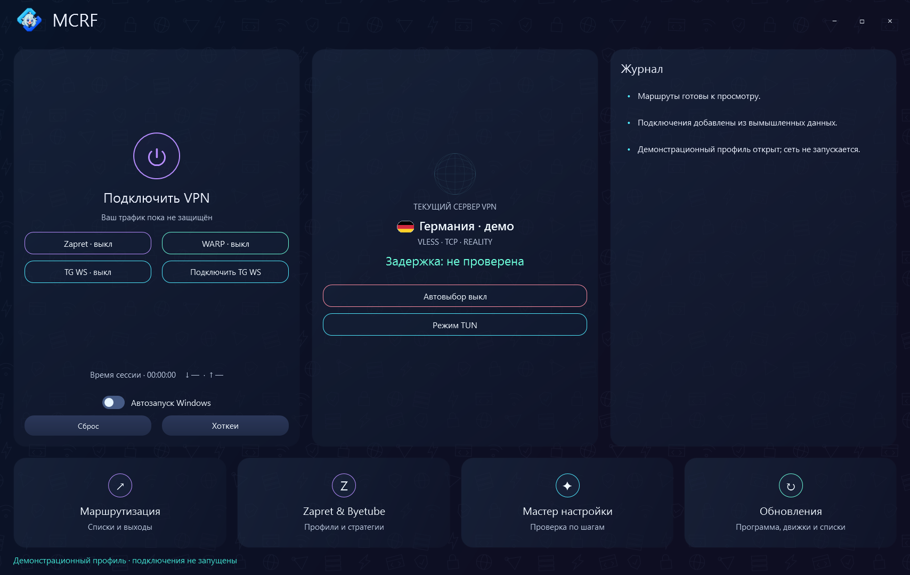

# MCRF

VPN и прокси для Android и Windows с гибкой маршрутизацией и настраиваемым интерфейсом. Linux-версия в разработке.

## Скачать

| Платформа | Версия |
| --- | --- |
| Windows x64 | [1.0.11](https://github.com/vnenapravo7-source/mcrf/releases/tag/v1.0.11) |
| Android 10+ | [0.1.0-preview.20261020.1](https://github.com/vnenapravo7-source/mcrf/releases/tag/android-v0.1.0-preview.20261020.1) |
| Linux | В разработке |

Всё управляется из приложения. Если для подключения нужен отсутствующий движок, MCRF предложит скачать его.

| Компонент | Протоколы | Происхождение |
| --- | --- | --- |
| [sing-box-lx](https://github.com/Leadaxe/sing-box-lx) | VLESS / REALITY, VMess, Trojan, Shadowsocks, Hysteria / Hysteria2, TUIC, AnyTLS, Naive, SSH, HTTP / HTTPS / SOCKS5, WireGuard / AmneziaWG | **Кастомная сборка MCRF** на базе sing-box-lx: маршруты, DNS и прямой выход |
| [Steer](https://github.com/splify2/steer) | VLESS / REALITY, VMess, Trojan, Shadowsocks, Hysteria2, HTTP / HTTPS, SOCKS4 / 4a / 5 | **Доработанный порт MCRF** для Android: правила, DNS, IPv6 и локальный прокси |
| [Компактный WG/AWG](ports/android/transports/wg-backend/) | WireGuard, AmneziaWG 3.0 / 3.1 | **Собственный модуль MCRF** на базе [wireguard-go](https://github.com/SagerNet/wireguard-go) |
| [Telegram WS](https://github.com/y0sy4/telegram-proxy) | Локальный SOCKS5-прокси для Telegram через WebSocket | Сторонний движок с адаптацией MCRF для Android |
| [Дополнительные транспорты](ports/android/transports/transport-lock.json) | CSQTT, WDTT, QWDTT, OLCRTC, DNSTT | Сторонние движки с адаптерами и пакетами MCRF |
| [Zapret для Windows](native/zapret-engine/README.md) | Обход DPI для TCP / UDP | **Кастомное расширение MCRF** для правил по приложениям; исходный движок также доступен |
| [ByeDPI](https://github.com/hufrea/byedpi) / ByeTube | Локальный SOCKS-прокси с обходом DPI | Сторонний движок обхода, интегрированный в интерфейс Windows |

## Возможности

- **Автоопределение БС на Android:** регулярная проверка доступности сети и автоматическое переключение VPN ↔ белые списки с уведомлением. Включается отдельно.
- **Гибкий дизайн:** светлая и тёмная темы, свои цвета, узоры, значки, минимализм, рандомайзер и анимации подключения.
- **Маршрутизация под свои задачи:** домены, IP, приложения, GeoIP/GeoSite, сервисные списки, приоритеты и отдельный DNS. Действия — напрямую, VPN или блокировка.
- **Большой выбор протоколов и движков:** VLESS, VMess, Trojan, Shadowsocks, Hysteria/2, WireGuard/AmneziaWG, HTTP/SOCKS5; дополнительные TURN- и DNS-транспорты. Возможности конкретного протокола зависят от выбранного движка.
- **Telegram WS-прокси**, WARP и локальный HTTP/SOCKS5 с авторизацией.
- **На Windows:** Zapret/ByeTube, редактор и генератор стратегий, игровые профили и маршрутизация обхода по приложениям.

## Android в действии

### Подключение и отключение

### Оформление

### Функции

### Разделы приложения

Записи настоящего приложения с существующими серверами. [Разделы и скриншоты подробнее](docs/ANDROID-GUIDE.md).

## Пул реализации Android

Основные возможности и доработки с начала разработки. Сейчас в работе **П2**.

### Уже есть

| Возможность | Статус |
| --- | --- |
| VPN, локальный прокси и выбор движка | Готово |
| Telegram WS-прокси | Готово |
| Локальные и WebDAV-копии настроек | Реализовано |

### П0 — интерфейс и исправления

| Задача | Статус |
| --- | --- |
| Гибкий дизайн: темы, цвета, узоры, значки, минимализм и анимации | Готово |
| Серверы и подписки: импорт, QR, редактор, экспорт и обновление | Готово |
| Поиск настроек, удобные группы и переход к нужному пункту | Готово |
| Правила для сайтов, IP и приложений; готовые списки и GeoIP/GeoSite | Реализовано |
| Автопереходы VPN ↔ БС, уведомления и боковые переключатели | Готово |
| Определять БС сразу перед подключением VPN | Дорабатывается |
| Фоновая работа, восстановление связи, уведомления и поведение в недавних | Реализовано |
| Удобный журнал и терминальный вид | Готово |
| Подключения S3 Bypass | Реализовано |

### П1 — компактные движки

| Задача | Статус |
| --- | --- |
| Steer: правила, DNS, IPv6 и прокси с логином/паролем | Готово |
| WG/AWG 3.0/3.1: подключение, IP-правила, блокировка и DNS | Готово |

### П2 — текущая работа

| Задача | Статус |
| --- | --- |
| Доработать DNS и прямой выход для IPv4 и IPv6 | В работе |
| Полностью останавливать движки и их дочерние процессы | В работе |
| Доработать автовыбор и замену неработающего сервера | В работе |
| Выбирать отдельный сервер для каждого правила маршрутов | В работе |
| Доработать поиск страны, повторные попытки и отмену в WARP | В работе |

### П3 — совместимость и протоколы

| Задача | Статус |
| --- | --- |
| Доработать капчу CSQTT, WDTT и QWDTT | Запланировано |
| Доработать OLCRTC и DNSTT; завершить TUIC, AnyTLS, NaiveProxy и SSH | Частично готово |
| Добавить VayDNS, SlipStream и MasterDNS | Запланировано |
| Переключаться на запасной движок при сбое, если это разрешено | Запланировано |
| Доработать переходы VPN ↔ БС в ограниченных сетях | Запланировано |
| Завершить совместимость всех маршрутов IPv4/IPv6 | Запланировано |

### П4 — обновления и развёртывание

| Задача | Статус |
| --- | --- |
| Доработать обновления остальных движков | Основное готово |
| Завершить автодеплой 3x-ui, SWG и S3 Bypass | Отложено |
| Доработать управление созданными серверами | Отложено |

**Отложено отдельно:** OpenFlux на Android.

**Финальный этап:** общая интеграция, документация и итоговый выпуск.

## Windows

[Все разделы Windows](docs/WINDOWS-GUIDE.md).

## Документация

[Android](docs/ANDROID-GUIDE.md) · [Windows](docs/WINDOWS-GUIDE.md) · [Сборка](docs/BUILD.md) · [Исходники](docs/DEVELOPMENT.md) · [Сообщить об ошибке](https://github.com/vnenapravo7-source/mcrf/issues)

Исходники, лицензии и контрольные суммы приложены к релизам.
