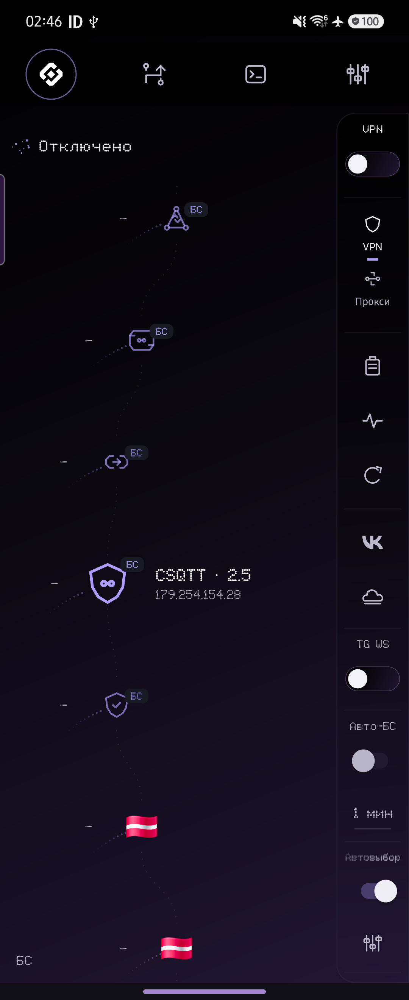
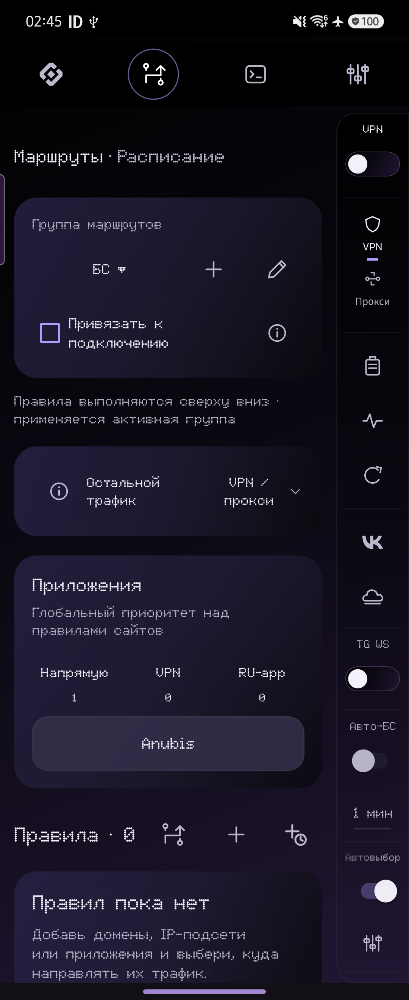
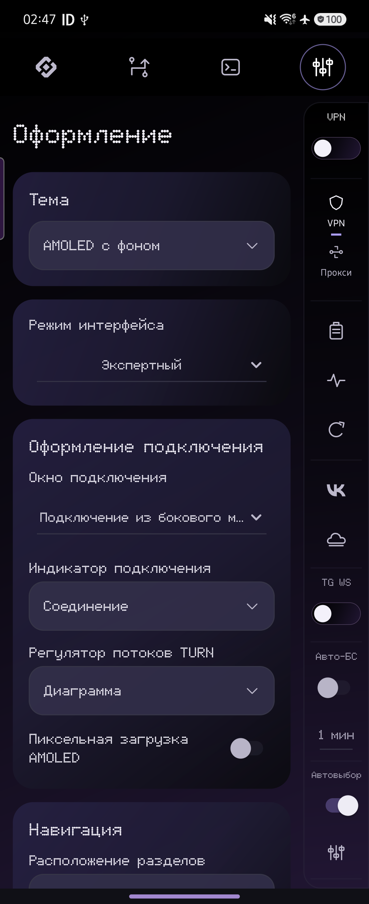
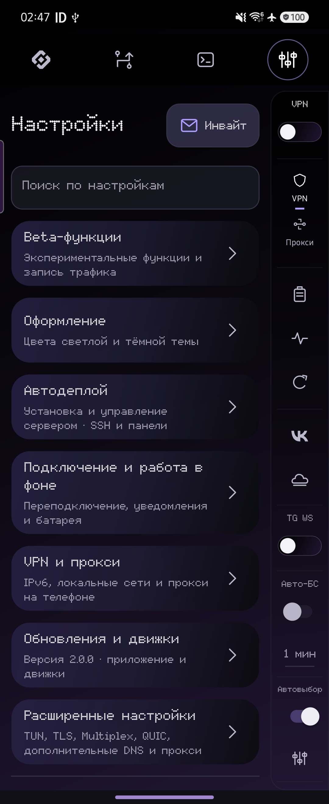
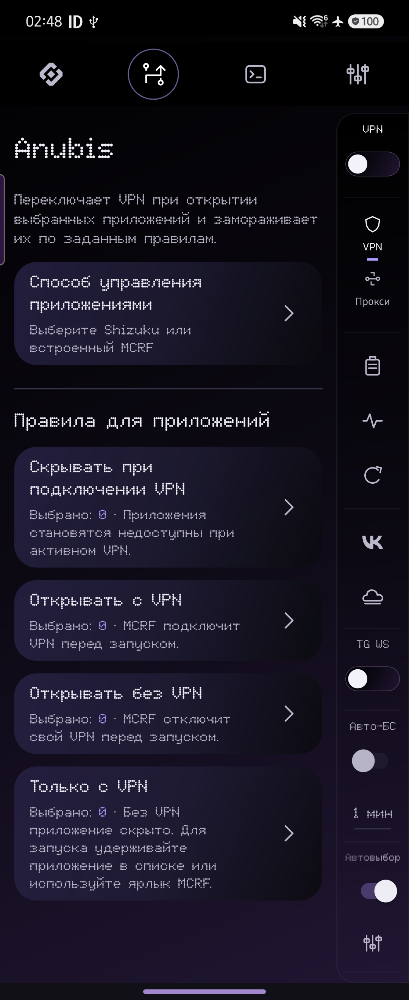
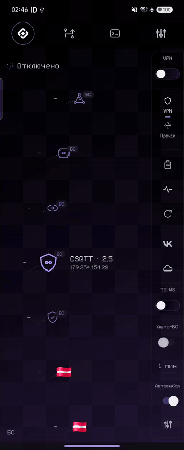
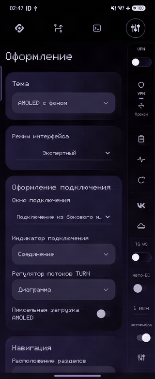
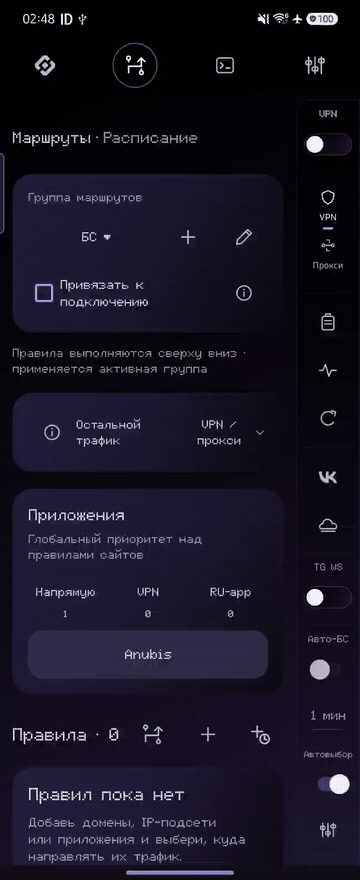
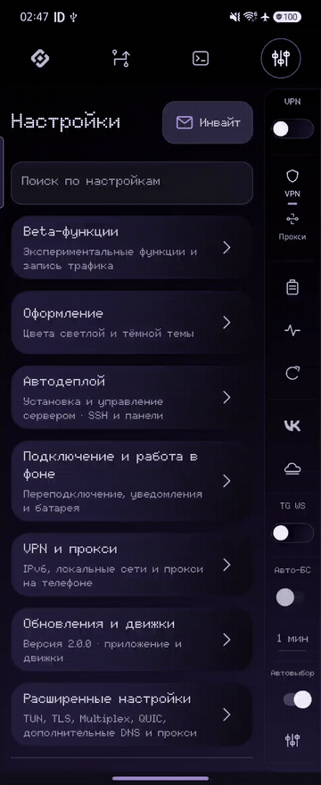

# MCRF

VPN и прокси для Android с гибкой маршрутизацией и настраиваемым интерфейсом. Linux и iOS версия в разработке.

## Скачать

| Платформа | Версия |
| --- | --- |
| Android 10+ | [2.0 — стабильный выпуск](https://github.com/vnenapravo7-source/mcrf/releases/tag/android-v2.0.0) · [универсальный APK](https://github.com/vnenapravo7-source/mcrf/releases/download/android-v2.0.0/mcrf-android-universal-release.apk) |
| iOS | В разработке |
| Linux | В разработке |

Универсальный APK поддерживает ARM64, ARMv7 и x86_64. При первом запуске приложение предложит скачать sing-box или Steer. Дополнительные движки загружаются по мере необходимости под архитектуру устройства. [Опубликованный каталог движков](https://github.com/vnenapravo7-source/mcrf/releases/tag/android-engines-v2.0.0).

### Бета-канал Android

[Android 2.0.0-beta.10178](https://github.com/vnenapravo7-source/mcrf/releases/tag/android-v2.0.0-beta.10178) включает исправления смешанной маршрутизации, очистки Slipstream и отключения бета-обновлений. Для получения бета-обновлений включите «Бета-версии приложения и движков» в разделе обновления движков. Для первого перехода со стабильной версии или с 10177 установите бета-APK со страницы выпуска. [Пакеты движков бета-канала](https://github.com/vnenapravo7-source/mcrf/releases/tag/android-v2.0.0-beta.10177) загружаются из приложения.

### Движки и протоколы

| Движок | Протоколы и назначение | Размер, МБ |
| --- | --- | --- |
| [sing-box-lx](https://github.com/Leadaxe/sing-box-lx) Кастомная сборка MCRF | VLESS / REALITY, VMess, Trojan, Shadowsocks, Hysteria / Hysteria 2 TUIC, AnyTLS, NaiveProxy, SSH, HTTP / HTTPS, SOCKS5, WireGuard / AmneziaWG | 30,5 |
| [Steer 0.3.3](https://github.com/splify2/steer) Доработанный порт MCRF, модуль 18 | VLESS / REALITY, VMess, Trojan, Shadowsocks, Hysteria 2 HTTP / HTTPS, SOCKS4 / 4a / 5 | 10,4 |
| [Компактный WireGuard / AmneziaWG](ports/android/transports/wg-backend/) Модуль MCRF на базе wireguard-go | WireGuard, AmneziaWG 3.0 / 3.1 | 3,5 |
| [Telegram-прокси через WebSocket](https://github.com/y0sy4/telegram-proxy) Сторонний, адаптирован для MCRF | SOCKS5 → WebSocket для Telegram | 4,3 |
| **Общий пакет MCRF для белых списков** Один общий исполняемый модуль и транспортная библиотека вместо повторной загрузки для каждого варианта | CSQTT 2.0 / 2.1.5 / 2.1.9; панель SWG 2.5.1 / 2.5.2 / 2.5.3; QWDTT | 10,6 arm64 |
| [Отдельный пакет WDTT](ports/android/transports/transport-lock.json) Единственный отдельный пакет для белых списков; остальные варианты входят в общий пакет | WDTT | 9,2 |
| [OpenFlux 0.17.1](https://github.com/p1neappleXpress/OpenFlux) Модуль из оригинального репозитория; JS-транспорты обновляются из [OpenFluxTransports](https://github.com/p1neappleXpress/OpenFluxTransports) | Зашифрованный Session/Direct и документные транспорты; транспорт FluxFast через протокол пользовательских датаграмм | — |
| [DNSTT](ports/android/transports/dnstt/) / [VayDNS](https://github.com/net2share/vaydns) / [SlipStream](https://github.com/EndPositive/slipstream) Отдельные адаптированные модули | Туннели системы доменных имён; VayDNS 0.2.8; SlipStream — совместимый модуль Mygod/slipstream-rust 0.1.1 | DNSTT: 5,8 VayDNS: 5,7 SlipStream: 7,6 |
| [MasterDnsVPN](https://github.com/masterking32/MasterDnsVPN) / [SSTP](https://github.com/ttrroyy/qThroneMobile/tree/8463d3397b0a8522f92811f5c0698679ab8efc77/carriers/sstp) Отдельные адаптированные модули | Туннель системы доменных имён / защищённый туннель SSTP | 4,0 / 5,4 |
| [Дополнительные протоколы — установочный пакет для Android, ARM64](https://github.com/vnenapravo7-source/mcrf/releases/download/engines-2026-10-13-1/mcrf-engine-protocols-arm64-v8a-release.apk) Отдельный пакет MCRF | TUIC, AnyTLS, NaiveProxy, SSH | 21,1 |
| [Xray](https://github.com/throneproj/xray-core) / [TLScore](https://github.com/throneproj/sing-box) Сторонние форки с адаптацией MCRF | Xray: VLESS / REALITY, VMess, Trojan, Shadowsocks, HTTP / SOCKS TLScore: VLESS, VMess, Trojan, HTTP / SOCKS и обход фильтрации TLS | Xray: 14,1 TLScore: 15,3 |
| [WarpScout](https://github.com/vernette/warpscout) Сторонний | Поиск WARP-подключений | 7,0 |

## Возможности

- **Автоопределение БС на Android:** регулярная проверка доступности сети и автоматическое переключение VPN ↔ белые списки с уведомлением. Включается отдельно.
- **Гибкий дизайн:** светлая и тёмная темы, свои цвета, узоры, значки, минимализм, рандомайзер и анимации подключения.
- **Маршрутизация под свои задачи:** домены, IP, приложения, GeoIP/GeoSite, сервисные списки, приоритеты и отдельный DNS. Действия — напрямую, VPN или блокировка.
- **Большой выбор протоколов и движков:** VLESS, VMess, Trojan, Shadowsocks, Hysteria/2, WireGuard/AmneziaWG, HTTP/SOCKS5; дополнительные TURN- и DNS-транспорты. Возможности конкретного протокола зависят от выбранного движка.
- **Telegram WS-прокси**, WARP и локальный HTTP/SOCKS5 с авторизацией.

## Android в действии

Android **2.0** на телефоне: текущий интерфейс, сохранённые серверы и настройки.

### Скриншоты

| Главная и серверы | Маршруты | Оформление | Настройки | Anubis |
| --- | --- | --- | --- | --- |
|  |  |  |  |  |

### Короткие записи

| Серверы | Оформление | Маршруты и Anubis | Настройки |
| --- | --- | --- | --- |
|  |  |  |  |

Каждый GIF — **6,8 секунды, 25 кадров/с**, без ускорения. [Разделы и скриншоты подробнее](docs/ANDROID-GUIDE.md).

## Версия для ПК

[Отдельный репозиторий MCRF для Windows](https://github.com/vnenapravo7-source/mcrf-desktop).

## Документация

[Android](docs/ANDROID-GUIDE.md) · [Исходники](docs/DEVELOPMENT.md) · [Сообщить об ошибке](https://github.com/vnenapravo7-source/mcrf/issues)

Исходники, лицензии и контрольные суммы приложены к релизам.
