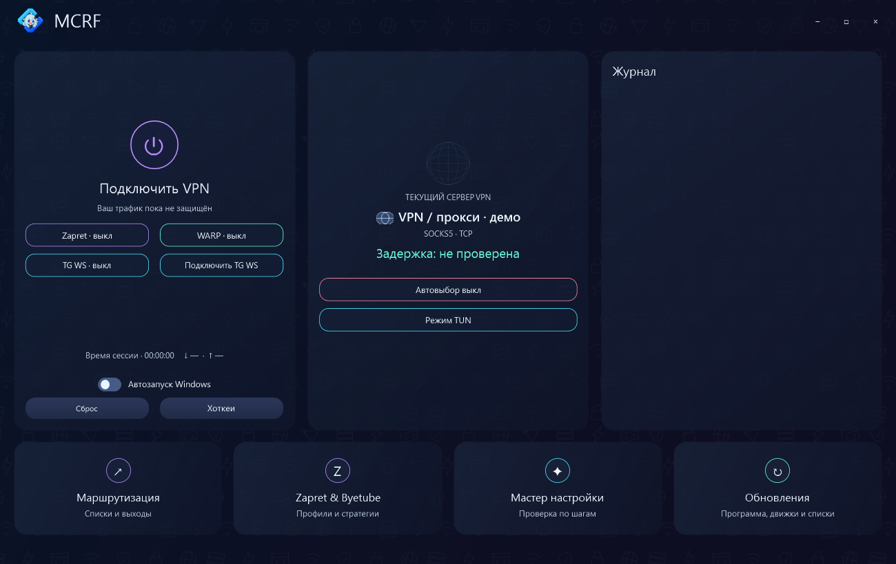
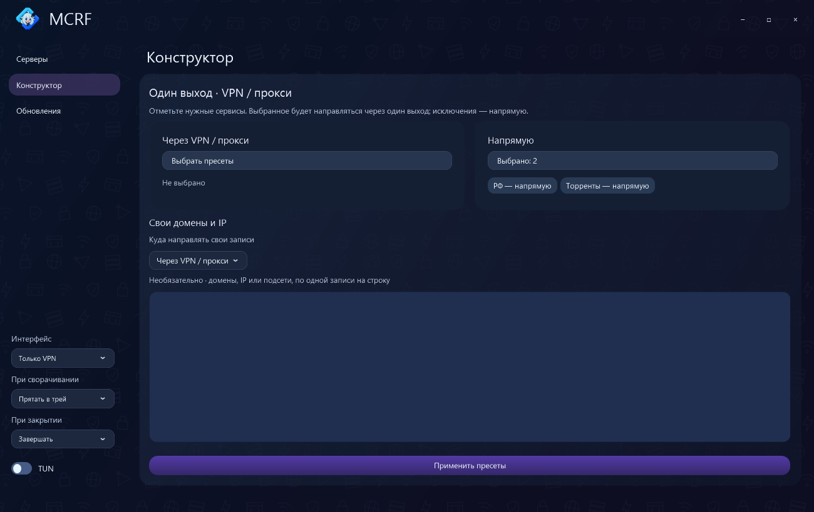

# MCRF

VPN и прокси для Android и Windows с гибкой маршрутизацией и настраиваемым интерфейсом. Linux-версия в разработке.

## Скачать

| Платформа | Версия |
| --- | --- |
| Windows x64 | [1.2](https://github.com/vnenapravo7-source/mcrf/releases/tag/v1.2) |
| Android 10+ | [0.7.2](https://github.com/vnenapravo7-source/mcrf/releases/tag/android-v0.7.2) |
| Linux | В разработке |

Для Android скачайте [универсальный APK 0.7.2](https://github.com/vnenapravo7-source/mcrf/releases/download/android-v0.7.2/mcrf-android-universal-release.apk). Движки устанавливаются отдельно под архитектуру устройства из [единого каталога](https://github.com/vnenapravo7-source/mcrf/releases/tag/engines-2026-10-13-1), включая OpenFlux **0.16.0**. [Матрица проверки и ограничения](docs/ANDROID-STATUS.md).

### Движки и протоколы

| Движок | Протоколы | APK, МБ |
| --- | --- | --- |
| [sing-box-lx](https://github.com/Leadaxe/sing-box-lx) Кастомная сборка MCRF | VLESS / REALITY, VMess, Trojan, SS, HY / HY2 TUIC, AnyTLS, Naive, SSH, HTTP(S), SOCKS5, WG / AWG | 30,5 |
| [Steer 0.3.3](https://github.com/splify2/steer) Доработанный порт MCRF, модуль 16 | VLESS / REALITY, VMess, Trojan, SS, HY2 HTTP(S), SOCKS4 / 4a / 5 | 10,4 |
| [Компактный WG/AWG](ports/android/transports/wg-backend/) Модуль MCRF на базе wireguard-go | WireGuard, AmneziaWG 3.0 / 3.1 | 3,5 |
| [Telegram WS](https://github.com/y0sy4/telegram-proxy) Сторонний, адаптирован для MCRF | SOCKS5 → WebSocket для Telegram | 4,3 |
| [TURN-транспорты](ports/android/transports/transport-lock.json) Сторонние, адаптированы для MCRF | CSQTT 2.0 / 2.1.5 / 2.1.9 / 2.5, SWG Panel 2.5.1, Rebirth 2.5; WDTT, QWDTT, OLCRTC | CSQTT: 12,7–13,1 WDTT: 9,2 QWDTT: 8,7 OLCRTC: 13,0 |
| [OpenFlux 0.16.0](https://github.com/OpenFluxTeam/OpenFlux) Отдельный модуль 15 | Зашифрованный Session/Direct и документные транспорты; UDP-транспорт FluxFast | 11,7 |
| [DNSTT](ports/android/transports/dnstt/) / [VayDNS](https://github.com/net2share/vaydns) / [SlipStream](https://github.com/EndPositive/slipstream) Отдельные адаптированные модули | DNS-туннели; VayDNS 0.2.8; SlipStream — совместимый backend Mygod/slipstream-rust 0.1.1 | DNSTT: 5,8 VayDNS: 5,7 SlipStream: 7,6 |
| [MasterDnsVPN](https://github.com/masterking32/MasterDnsVPN) / [SSTP](https://github.com/ttrroyy/qThroneMobile/tree/8463d3397b0a8522f92811f5c0698679ab8efc77/carriers/sstp) Отдельные адаптированные модули | DNS-туннель / SSTP | 4,0 / 5,4 |
| [Модуль дополнительных протоколов — APK ARM64](https://github.com/vnenapravo7-source/mcrf/releases/download/engines-2026-10-13-1/mcrf-engine-protocols-arm64-v8a-release.apk) Отдельный пакет MCRF | TUIC, AnyTLS, NaiveProxy, SSH | 21,1 |
| [Xray](https://github.com/throneproj/xray-core) / [TLScore](https://github.com/throneproj/sing-box) Сторонние форки с адаптацией MCRF | Xray: VLESS / REALITY, VMess, Trojan, SS, HTTP / SOCKS TLScore: VLESS, VMess, Trojan, HTTP / SOCKS + TLS fragmentation / tricks | Xray: 14,1 TLScore: 15,3 |
| [WarpScout](https://github.com/vernette/warpscout) Сторонний | Поиск WARP-подключений | 7,0 |
| [Zapret](native/zapret-engine/README.md) / [ByeDPI](https://github.com/hufrea/byedpi) · ByeTube Windows: Zapret — расширение MCRF; ByeDPI — сторонний | Обход DPI: TCP / UDP и локальный SOCKS-прокси | В приложении Windows |

APK — размер загрузки для Android arm64, округлённый до 0,1 МБ (1 МБ = 1 000 000 байт), по проверенным пакетам каталога 0.7. После установки размер больше. SS — Shadowsocks, HY / HY2 — Hysteria / Hysteria2, WG / AWG — WireGuard / AmneziaWG. [Версии CSQTT, SWG и ограничения проверки](docs/ANDROID-GUIDE.md#версии-csqtt-и-swg).

## Возможности

- **Автоопределение БС на Android:** регулярная проверка доступности сети и автоматическое переключение VPN ↔ белые списки с уведомлением. Включается отдельно.
- **Гибкий дизайн:** светлая и тёмная темы, свои цвета, узоры, значки, минимализм, рандомайзер и анимации подключения.
- **Маршрутизация под свои задачи:** домены, IP, приложения, GeoIP/GeoSite, сервисные списки, приоритеты и отдельный DNS. Действия — напрямую, VPN или блокировка.
- **Большой выбор протоколов и движков:** VLESS, VMess, Trojan, Shadowsocks, Hysteria/2, WireGuard/AmneziaWG, HTTP/SOCKS5; дополнительные TURN- и DNS-транспорты. Возможности конкретного протокола зависят от выбранного движка.
- **Telegram WS-прокси**, WARP и локальный HTTP/SOCKS5 с авторизацией.
- **На Windows:** Zapret/ByeTube, редактор и генератор стратегий, игровые профили и маршрутизация обхода по приложениям.

## Android в действии

| Подключение и отключение | Оформление | Функции | Разделы |
| --- | --- | --- | --- |
|  |  |  |  |

Записи настоящего приложения с существующими серверами. [Разделы и скриншоты подробнее](docs/ANDROID-GUIDE.md).

## Пул реализации Android

Показать план и статусы по приоритетам

Актуализация: **28 октября 2026**. Подробности проверок и оставшиеся ограничения — в [отдельной матрице](docs/ANDROID-STATUS.md).

| Приоритет | Задача | Статус |
| --- | --- | --- |
| П0 | VPN, локальный прокси и выбор движка | Готово |
| П0 | Импорт, QR, редактор, экспорт и подписки | Готово |
| П0 | Пинг, ручной выбор и переключение серверов | Готово |
| П0 | Темы, оформление и анимации | Готово |
| П0 | Поиск и группы настроек | Готово |
| П0 | Маршруты, приложения, GeoIP/GeoSite и исключения | Готово |
| П0 | №47: быстрый выбор приложений | Готово |
| П0 | Прямой выход и совместимость IPv4 | Готово |
| П0 | Автоопределение БС и проверка перед подключением | Готово |
| П0 | Три настраиваемых сайта проверки наличия БС | Готово |
| П0 | Окно VK и обновление списка после добавления сервера | Готово |
| П0 | Фоновая работа, смена сети и уведомления | Готово |
| П0 | Telegram WS-прокси | Готово |
| П0 | Настройки аккаунта, звонков и капчи VK Turn | Готово |
| П0 | Подключения S3 Bypass | Готово |
| П0 | Логи и копирование отчёта | Готово |
| П0 | Зашифрованные копии и WebDAV | Готово |
| П0 | Обновление приложения и отдельных движков | Готово |
| П1 | Steer: маршруты, DNS, IPv6 и локальный прокси | Готово |
| П1 | Компактный WG/AWG 3.0/3.1 | Готово |
| П2 | DNS правил и VPN-серверов | Готово |
| П2 | Остановка движков и дочерних процессов | Готово |
| П2 | Автовыбор и отдельные серверы для маршрутов | Готово |
| П2 | Три группы маршрутов и плитки Android | Готово |
| П2 | Привязка маршрутов к типу подключения, списки VPN и БС | Готово |
| П2 | Импорт CSQTT, SWG Panel и Rebirth | Готово |
| П2 | VK Turn: потоки, TLS, Wi-Fi и выключенный экран | Готово |
| П2 | №57: панели, подключения и именованные установки | Готово |
| П2 | WARP: страна, WG/AWG и отмена поиска | Готово |
| П2 | Настраиваемые счётчики и снижение фоновой активности | Готово |
| П3 | Капча: реальные сценарии VK | Частично |
| П3 | OLCRTC и DNSTT: полная серверная совместимость | Частично |
| П3 | TUIC, AnyTLS, NaiveProxy и SSH | Готово |
| П3 | VayDNS и SlipStream | Готово |
| П3 | CSQTT 2.5: APK для ARMv7 и x86_64 | Готово |
| П3 | Восстановление после пробуждения без самозапуска VPN | Готово |
| П3 | Запасной движок при сбое | Готово |
| П3 | VPN ↔ БС: все реальные сетевые сценарии | Частично |
| П3 | IPv4/IPv6: полная сквозная матрица движков | Частично |
| П3 | OpenFlux 0.16, FluxFast и переподключение | Готово |
| П4 | Обновление дополнительных движков | Готово |
| П4 | №48: MasterDnsVPN — модуль и импорт | Готово |
| П4 | №50: SSTP — модуль и импорт | Готово |
| П4 | Расширенное управление серверами | Отложено |
| П4 | Автодеплой S3 Bypass | Отложено |

## Windows

[Все разделы Windows](docs/WINDOWS-GUIDE.md).

## Документация

[Android](docs/ANDROID-GUIDE.md) · [Windows](docs/WINDOWS-GUIDE.md) · [Сборка](docs/BUILD.md) · [Исходники](docs/DEVELOPMENT.md) · [Сообщить об ошибке](https://github.com/vnenapravo7-source/mcrf/issues)

Исходники, лицензии и контрольные суммы приложены к релизам.
