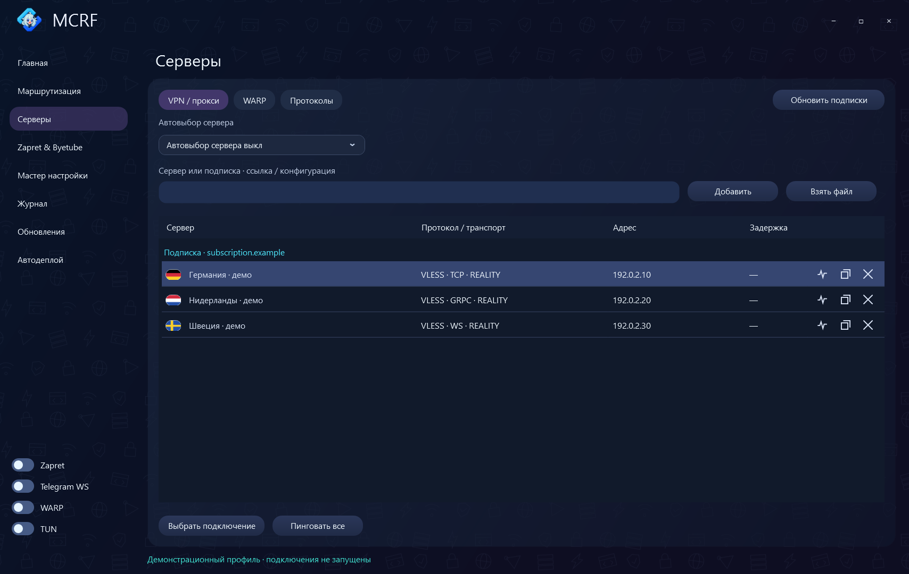
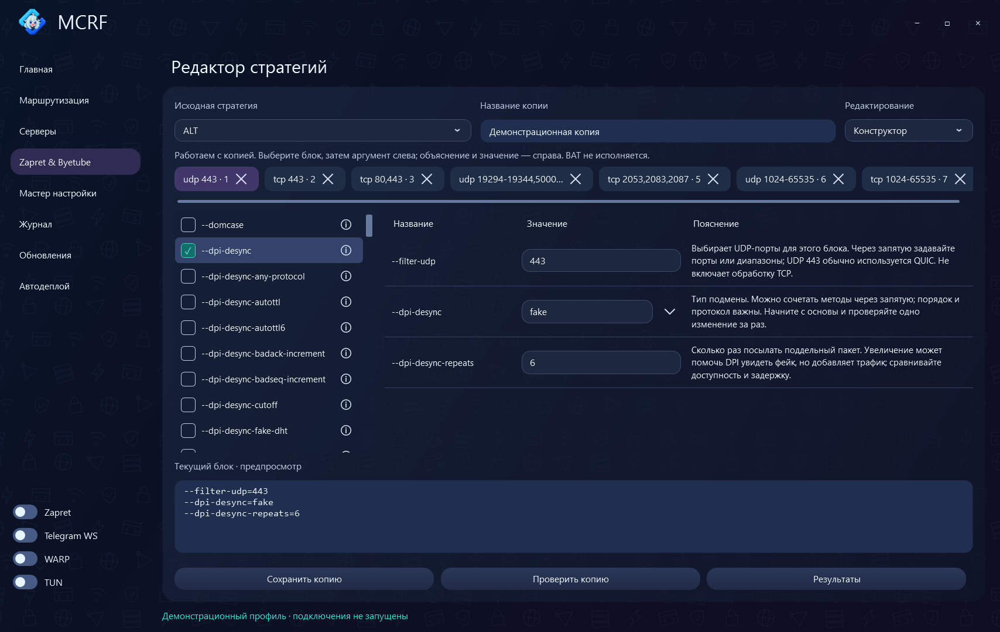
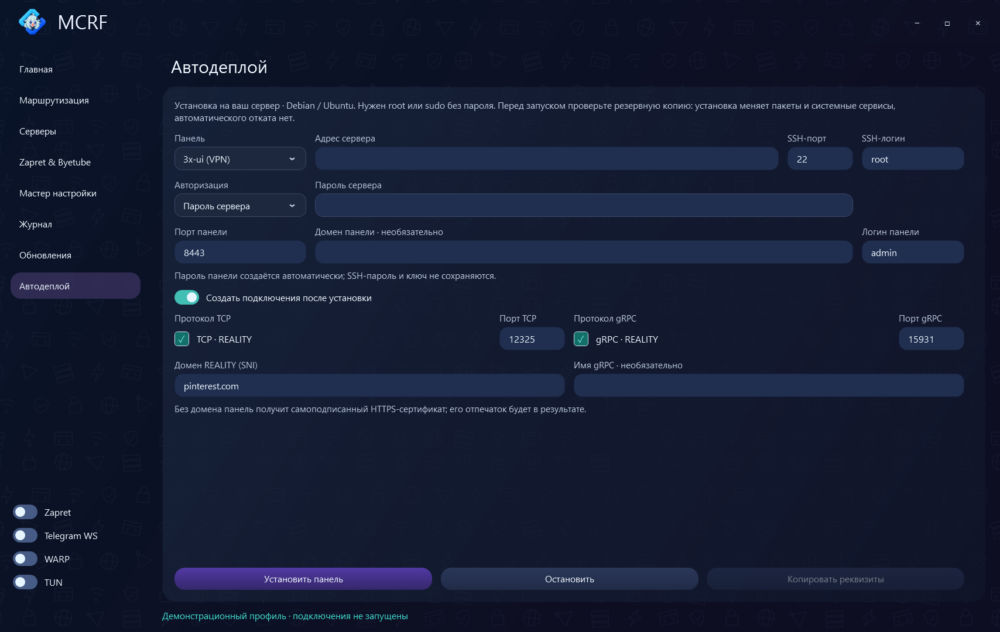

# MCRF

Windows-клиент: VPN, WARP, Zapret, ByeTube, локальные прокси и маршрутизация сервисов в одном приложении.

[Стабильная версия](https://github.com/vnenapravo7-source/mcrf/releases/tag/v0.3.10) · [Предрелиз 1.0.11](https://github.com/vnenapravo7-source/mcrf/releases/tag/v1.0.11) · [Сообщить о проблеме](https://github.com/vnenapravo7-source/mcrf/issues)

## Предрелиз Windows 1.0.11

**Известные риски:** на предоставленном отчёте VirusTotal для этого EXE — 4/70 срабатывания; их причины и ложноположительность не подтверждены. Подробности и непроверенные сценарии перечислены в [описании релиза](docs/releases/1.0.11.md).

Один новый WPF-интерфейс, новый логотип и один `mcrf.exe`. Основные ресурсы распаковываются по необходимости; дополнительные OpenFlux/CSQTT/WDTT/QWDTT устанавливаются из приложения с GitHub после проверки SHA-256. Локальные ZIP для установки движков не нужны.

| Раздел | Возможности |
| --- | --- |
| Главная | Подключение, сервер, состояние сети и краткий журнал |
| Маршрутизация | Упорядоченные правила для доменов, IP и приложений; назначение выходов и DNS; hosts Instagram/ChatGPT и дополнительных сервисов |
| Серверы | Импорт ссылок, файлов и подписок; задержка и автовыбор; WARP; таблица протоколов |
| Zapret & ByeTube | Профили обхода и редактор стратегии с прокручиваемыми разделами, таблицей аргументов и пояснениями |
| Мастер настройки | Подбор и проверки стратегий с сохранением результатов и ручным подтверждением |
| Журнал | События клиента и движков, фильтры и копирование |
| Обновления | Программа, дополнительные движки, стратегии и списки; установка по выбору пользователя |
| Автодеплой | Установка 3x-ui, OpenFlux или SWG по SSH на Debian/Ubuntu; создание выбранных профилей и выдача реквизитов, ключей и QR |

### Протоколы

VLESS TCP/gRPC/WebSocket/HTTPUpgrade/XHTTP с TLS/REALITY; VMess, Trojan, Shadowsocks; WireGuard/AmneziaWG и WARP; Hysteria/Hysteria2, TUIC, AnyTLS, NaiveProxy, SSH, HTTP/SOCKS5. Требуются совместимый сервер и корректный профиль; наличие протокола не гарантирует доступность в конкретной сети.

| Дополнительный движок | Назначение |
| --- | --- |
| [OpenFlux](https://github.com/p1neappleXpress/OpenFlux) | Защищённый туннель с выбором носителя; импорт `openflux://v1/` |
| [WDTT](https://github.com/ildarmaga/wdtt) | WireGuard через DTLS/TURN, локальный SOCKS5-выход |
| [CSQTT](https://github.com/amurcanov/csqtt) | TURN/RTP-туннель и локальный мост; некоммерческая лицензия компонента |
| [QWDTT](https://github.com/SpaceNeuroX/proxy-turn-vk-android) | Отдельный Windows-клиент QUIC/TURN; основной EXE его не содержит |

Движки подключаются к общей маршрутизации и TUN. Их исходники и лицензии доступны в релизах дополнительных движков.

### Редактор стратегий

Аргументы, значения и пояснения — в одной таблице; разделы прокручиваются мышью, подсказки открываются при наведении или нажатии «i».

### Автодеплой

- 3x-ui: выбранные VLESS TCP и/или gRPC REALITY, отдельные порты, SNI и имя gRPC.
- OpenFlux: Direct либо внешний носитель; действительный ключ шифрования, ссылка импорта и QR.
- SWG: CSQTT/WDTT/QWDTT и привязка звонков VK. Ручные ссылки не требуют входа; вставка нескольких ссылок создаёт отдельные поля. Для автоматического создания шести звонков сначала открывается главная vk.ru, затем получение токена в той же сессии.

Подключения показываются в отдельном разделе и не запускаются автоматически после импорта. Последний результат деплоя защищён DPAPI текущего пользователя Windows; SSH-пароль/ключ и VK-токен не сохраняются в нём.

Установка изменяет серверные пакеты и службы, автоматического полного отката нет. Существующая панель и занятый порт не перезаписываются. Перед работой сделайте резервную копию сервера и проверьте отпечаток SSH.

## Запуск

1. Скачайте `mcrf.exe` и сверьте его с `SHA256SUMS.txt` из того же релиза.
2. Закройте другой MCRF. Для TUN, Zapret и изменения системного hosts нужны права администратора.
3. Импортируйте свой сервер или подписку; приложение не предоставляет VPN-сервер или подписку.
4. Назначьте выходы нужным правилам и проверьте подключение.

Windows x64, .NET Framework 4.8; вход VK использует установленный WebView2 Runtime. Новый интерфейс хранит отдельный профиль `%LOCALAPPDATA%\mcrf-wpf`; профиль старого интерфейса автоматически не переносится.

## Проверка файла и сборка

EXE не подписан Authenticode. Контрольная сумма опубликована рядом с ним. [Отчёт VirusTotal для переданного финального файла](https://www.virustotal.com/gui/file-analysis/Y2YyNzAwMGMwZWE1Yjc3OTkyYzkyYWQ1ZTkzN2I4MzE6MTc5MTkxNDYxMw==) предоставлен пользователем; SHA-256 на предоставленном скриншоте совпадает с кандидатом. На скриншоте показаны 4/70 срабатывания (Kaspersky, McAfee Scanner, SecureAge, Trapmine), причины которых ещё не подтверждены. Публикация разрешена владельцем с сохранением этого предупреждения. Отчёт не гарантирует безопасность.

Лицензии сторонних компонентов сохраняются и встроены в приложение. Исходники: [WPF-интерфейс](wpf/), [общая модель и Windows-движки](native/). [Сборка и зависимости](docs/BUILD.md), [документация разработчика](docs/DEVELOPMENT.md).

