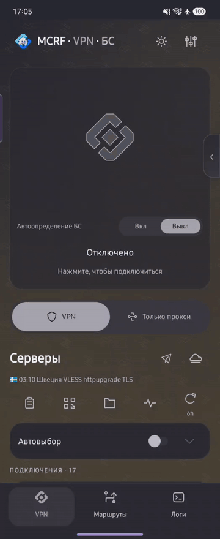
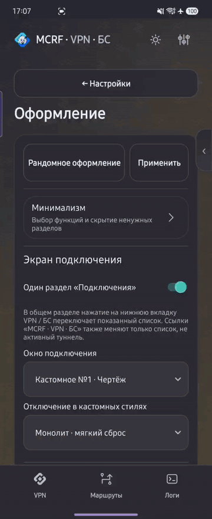
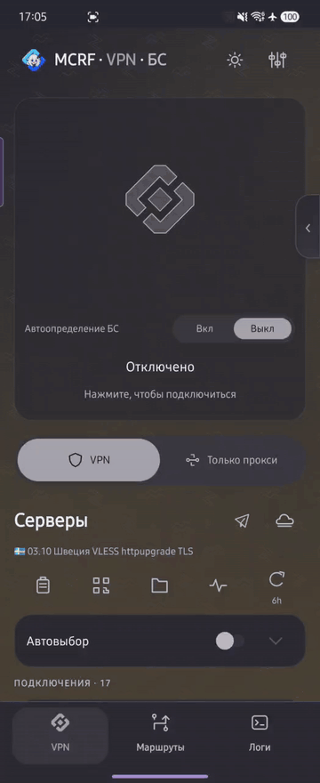
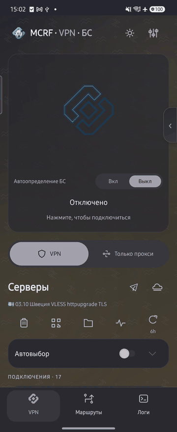
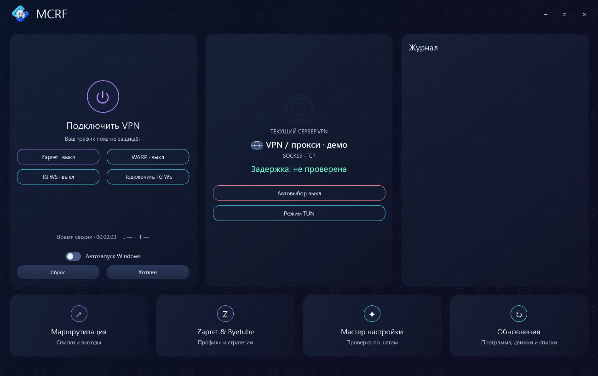
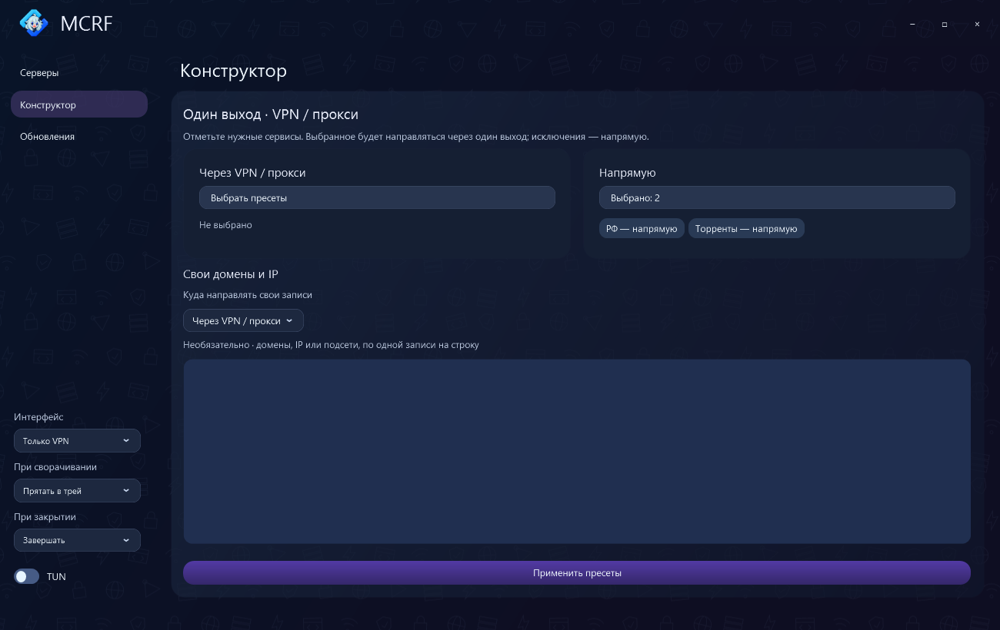

# MCRF

VPN и прокси для Android и Windows с гибкой маршрутизацией и настраиваемым интерфейсом. Linux и iOS версия в разработке.

## Скачать

| Платформа | Версия |
| --- | --- |
| Windows x64 | [1.2](https://github.com/vnenapravo7-source/mcrf/releases/tag/v1.2) · [Скачать EXE](https://vnenapravo7.ru/mcrf-downloads/d/678292801) |
| Android 10+ | [0.7.3 — текущий опубликованный выпуск](https://github.com/vnenapravo7-source/mcrf/releases/tag/android-v0.7.3) |
| iOS | В разработке |
| Linux | В разработке |

### Движки и протоколы

| Движок | Протоколы и назначение | Размер, МБ |
| --- | --- | --- |
| [sing-box-lx](https://github.com/Leadaxe/sing-box-lx) Кастомная сборка MCRF | VLESS / REALITY, VMess, Trojan, Shadowsocks, Hysteria / Hysteria 2 TUIC, AnyTLS, NaiveProxy, SSH, HTTP / HTTPS, SOCKS5, WireGuard / AmneziaWG | 30,5 |
| [Steer 0.3.3](https://github.com/splify2/steer) Доработанный порт MCRF, модуль 16 | VLESS / REALITY, VMess, Trojan, Shadowsocks, Hysteria 2 HTTP / HTTPS, SOCKS4 / 4a / 5 | 10,4 |
| [Компактный WireGuard / AmneziaWG](ports/android/transports/wg-backend/) Модуль MCRF на базе wireguard-go | WireGuard, AmneziaWG 3.0 / 3.1 | 3,5 |
| [Telegram-прокси через WebSocket](https://github.com/y0sy4/telegram-proxy) Сторонний, адаптирован для MCRF | SOCKS5 → WebSocket для Telegram | 4,3 |
| **Общий пакет MCRF для белых списков** Один общий исполняемый модуль и транспортная библиотека вместо повторной загрузки для каждого варианта | CSQTT 2.0 / 2.1.5 / 2.1.9; панель SWG 2.5.1 / 2.5.2 / 2.5.3; QWDTT | 10,6 arm64 |
| [Отдельный пакет WDTT](ports/android/transports/transport-lock.json) Единственный отдельный пакет для белых списков; остальные варианты входят в общий пакет | WDTT | 9,2 |
| [OpenFlux 0.17.1](https://github.com/p1neappleXpress/OpenFlux) Модуль из оригинального репозитория; JS-транспорты обновляются из [OpenFluxTransports](https://github.com/p1neappleXpress/OpenFluxTransports) | Зашифрованный Session/Direct и документные транспорты; транспорт FluxFast через протокол пользовательских датаграмм | — |
| [DNSTT](ports/android/transports/dnstt/) / [VayDNS](https://github.com/net2share/vaydns) / [SlipStream](https://github.com/EndPositive/slipstream) Отдельные адаптированные модули | Туннели системы доменных имён; VayDNS 0.2.8; SlipStream — совместимый модуль Mygod/slipstream-rust 0.1.1 | DNSTT: 5,8 VayDNS: 5,7 SlipStream: 7,6 |
| [MasterDnsVPN](https://github.com/masterking32/MasterDnsVPN) / [SSTP](https://github.com/ttrroyy/qThroneMobile/tree/8463d3397b0a8522f92811f5c0698679ab8efc77/carriers/sstp) Отдельные адаптированные модули | Туннель системы доменных имён / защищённый туннель SSTP | 4,0 / 5,4 |
| [Дополнительные протоколы — установочный пакет для Android, ARM64](https://github.com/vnenapravo7-source/mcrf/releases/download/engines-2026-10-13-1/mcrf-engine-protocols-arm64-v8a-release.apk) Отдельный пакет MCRF | TUIC, AnyTLS, NaiveProxy, SSH | 21,1 |
| [Xray](https://github.com/throneproj/xray-core) / [TLScore](https://github.com/throneproj/sing-box) Сторонние форки с адаптацией MCRF | Xray: VLESS / REALITY, VMess, Trojan, Shadowsocks, HTTP / SOCKS TLScore: VLESS, VMess, Trojan, HTTP / SOCKS и обход фильтрации TLS | Xray: 14,1 TLScore: 15,3 |
| [WarpScout](https://github.com/vernette/warpscout) Сторонний | Поиск WARP-подключений | 7,0 |
| [Zapret](native/zapret-engine/README.md) / [ByeDPI](https://github.com/hufrea/byedpi) · ByeTube Windows: Zapret — расширение MCRF; ByeDPI — сторонний | Обход глубокой фильтрации трафика: TCP / UDP и локальный SOCKS-прокси | В приложении Windows |

## Возможности

- **Автоопределение БС на Android:** регулярная проверка доступности сети и автоматическое переключение VPN ↔ белые списки с уведомлением. Включается отдельно.
- **Гибкий дизайн:** светлая и тёмная темы, свои цвета, узоры, значки, минимализм, рандомайзер и анимации подключения.
- **Маршрутизация под свои задачи:** домены, IP, приложения, GeoIP/GeoSite, сервисные списки, приоритеты и отдельный DNS. Действия — напрямую, VPN или блокировка.
- **Большой выбор протоколов и движков:** VLESS, VMess, Trojan, Shadowsocks, Hysteria/2, WireGuard/AmneziaWG, HTTP/SOCKS5; дополнительные TURN- и DNS-транспорты. Возможности конкретного протокола зависят от выбранного движка.
- **Telegram WS-прокси**, WARP и локальный HTTP/SOCKS5 с авторизацией.
- **На Windows:** Zapret/ByeTube, редактор и генератор стратегий, игровые профили и маршрутизация обхода по приложениям.

## Android в действии

| Подключение и отключение | Оформление | Функции | Разделы |
| --- | --- | --- | --- |
|  |  |  |  |

Записи настоящего приложения с существующими серверами. [Разделы и скриншоты подробнее](docs/ANDROID-GUIDE.md).

## Пул реализации Android

Показать все задачи и статусы по приоритетам

Актуализация: **2 ноября 2026**. Задачи объединены по функциональным областям, порядок — П0 → П4. Завершённый объём прежних выпусков сохраняет статус «Готово»; новые расширения и незакрытые проверки перечислены отдельно.

«Исходники готовы» — код подготовлен, итоговая приёмка открыта. «Проверяется» и «Частично» описывают незавершённую проверку указанного объёма; «Нужен аудит» — статус ещё требуется установить. Общая приёмка 2.0 не переоткрывает прежние закрытые задачи.

| № | Приоритет | Область / задача | Статус | Примечание |
| --- | --- | --- | --- | --- |
| 1 | П0 | Подключение и локальный HTTP/SOCKS5-прокси | Готово | Выбор движка, IPv4/прямой выход, фоновая работа и смена сети, корректная остановка процессов. Состояние, IP/потоки TURN и счётчики на главной и в уведомлении; адрес выключенного прокси скрывается. |
| 2 | П0 | Маршрутизация по доменам, IP и приложениям | Готово | GeoIP/GeoSite, исключения и быстрый выбор приложений. Новые режимы и проверка конфликтов — ниже. |
| 3 | П0 | Серверы и подписки | Готово | Импорт ссылок/QR, редактор и экспорт, пинг/ручное переключение; URL, расписания, статусы и группы подписок с сохранением прежних записей при ошибке обновления. |
| 4 | П0 | Автоопределение БС и проверка перед подключением | Готово | Три настраиваемых сайта: два напрямую, третий через VPN. Полная матрица реальных переходов — ниже. |
| 5 | П0 | Локальные зашифрованные копии и восстановление | Готово | Прежний принятый объём сохранён; новые история, предпросмотр и отмена восстановления — ниже. |
| 6 | П0 | Обновления приложения и отдельных движков | Готово | Целостность, подпись, ABI, установка/удаление и разрешения Android; диагностика APK/Huawei/OEM. Новый BS и проверка проблемного Huawei — ниже. |
| 7 | П0 | Оформление, настройки и первый запуск | Готово | Темы, цвета, узоры, значки, анимации, рандомайзер при возврате; поиск/группы/подстраницы и выбор нужных функций. Изменения интерфейса 2.0 — ниже. |
| 8 | П0 | VK/TURN и Telegram WS: подключение и настройки | Готово | Окно VK, обновление списка серверов, аккаунт/звонки/CAPTCHA; настройка Telegram WS. Приёмка всех внешних провайдеров — ниже. |
| 9 | П0 | Логи и отчёт об ошибке | Готово | Фильтры, копирование и отчёт без секретов. |
| 10 | П0 | Интерфейс 2.0 и обновление каталога в фоне | Проверяется | Нижняя навигация, карточки, диалоги и редакторы маршрутов/DNS, сворачиваемые настройки; снимки каталога при старте/возврате. Исходники готовы; итоговая компиляция и визуальная приёмка открыты, ускорение не измерено. |
| 11 | П0 | Steer: protect/bind и защита от повторного close/reuse fd | Частично | Callbacks и локальный IPv4 TUN подтверждены. Полная проверка вспомогательных путей и close/fd-reuse требует аудита. |
| 12 | П1 | Steer: маршруты, DNS, IPv6 и локальный прокси | Готово | Принятый объём сохранён; расширенные замечания review — отдельно. |
| 13 | П1 | Компактный WireGuard/AmneziaWG 3.0/3.1 | Готово | Отдельный модуль. |
| 14 | П1 | Steer: расширенная DNS/negative/load-матрица | Частично | A/AAAA, SERVFAIL/no-fallback, proxy-auth и TLS refusal проверены в своём объёме. TTL/CNAME/очистка synthetic IPv6, очереди/overflow, нагрузка и полная DNS/.srs/regex/handshake-матрица требуют проверки. |
| 15 | П2 | Автопул и отдельные серверы маршрутов | Готово | Ручной выбор, автоматические пробы, остановка/отмена и читаемый статус пула. |
| 16 | П2 | Расширенные правила, группы и DNS | Готово | RU-direct, глобальные VPN-only/direct-only приложения, приоритеты, выход остального трафика; три группы/плитки Android, списки VPN/БС и привязка к подключению. GeoIP/GeoSite: импорт, источники, пресеты и ленивые наборы. DNS правил/серверов; TURN без пользовательских правил. |
| 17 | П2 | Редактор параметров соединения | Готово | TLS/MUX/uTLS/QUIC и переопределения с учётом возможностей выбранного ядра. |
| 18 | П2 | CSQTT, SWG Panel и Rebirth: импорт и параметры TURN | Готово | Потоки, TLS, Wi-Fi и выключенный экран. Новый общий пакет и совместимость — ниже. |
| 19 | П2 | Панели, подключения и именованные установки | Готово | Прежний объём №57; подключение S3 Bypass сохранено. Обновление автодеплоя SWG — ниже. |
| 20 | П2 | WARP: регистрация, поиск и WG/AWG-профили | Готово | Страна, ограниченные попытки, отмена и читаемый статус; раздел серверов. |
| 21 | П2 | Счётчики и снижение фоновой активности | Готово | Прежние настройки сохранены; новый монитор и энергосбережение — ниже. |
| 22 | П2 | Общий BS и совместимость сохранённых CSQTT | Проверяется | CSQTT 2.0/2.1.5/2.1.9, SWG 2.5.1/2.5.2/2.5.3 и QWDTT; WDTT отдельно. BS2.0-bs.4 собран/установлен. Автоподбор, миграция ссылок/подписок/правил, VK/Flood backoff, TURN-подсети и ручные потоки подготовлены; полная серверная/process-death-приёмка и доставка открыты. |
| 23 | П2 | Установка одного/всех движков и общие карточки VPN/БС | Исходники готовы | Общий BS скачивается один раз; итоговая UI/installer-приёмка ожидается. |
| 24 | П2 | Автодеплой актуальной официальной версии SWG | Исходники готовы | Одна закреплённая версия на установку. Компиляция и локальные проверки пройдены; дополнительная проверка исправления и удалённая установка открыты. |
| 25 | П2 | Steer: событийное ожидание и повторное использование DNS/.srs через C/JNI | Нужен аудит | Свежего подтверждения завершения этих замечаний review нет. |
| 26 | П3 | OpenFlux 0.16: Direct, FluxFast и переподключение | Готово | Ранее приняты собственные изолированные выходы. Переход на официальный upstream и внешние провайдеры — отдельно. |
| 27 | П3 | Дополнительные модули и архитектуры | Готово | TUIC/AnyTLS/NaiveProxy/SSH, VayDNS/SlipStream, OLCRTC/DNSTT, MasterDnsVPN/SSTP; импорт, настройки и lifecycle в принятом объёме. APK CSQTT 2.5 для ARMv7/x86_64 и обновления модулей; полная server/ABI-матрица — ниже. |
| 28 | П3 | Восстановление после пробуждения, запасной движок и Kill switch | Готово | Прежние сценарии сохранены; пробуждение без самозапуска VPN. Расширенное автовосстановление — ниже. |
| 29 | П3 | Steer: IPv4 TCP VLESS через host-owned TUN | Готово | Локальные GET/POST, protect/bind и STOP приняты; другие протоколы/DNS/IPv6 входят в общую матрицу. |
| 30 | П3 | Все реальные переходы VPN ↔ БС и сквозная IPv4/IPv6-матрица | Частично | Ранее принятые сценарии не переоткрываются; все сети и движки ещё не проверены. |
| 31 | П3 | Полная совместимость провайдеров, серверов и физических ABI | Частично | VK/CAPTCHA/MASQUE, OLCRTC/DNSTT, SSTP/MasterDnsVPN, пары CSQTT/форков, ARMv7/x86_64. Наличие UI или APK не закрывает эту матрицу. |
| 32 | П3 | Установка на конкретном проблемном Huawei | Проверяется | Исправления установщика готовы; подтверждения на этом OEM нет. |
| 33 | П3 | OpenFlux: внешние документные провайдеры и экспериментальные режимы | Частично | Ранее принятые Direct/FluxFast не доказывают все NAT/provider/ownHTTP/inline/script-сценарии. |
| 34 | П4 | Простой и экспертный режимы | Исходники готовы | Скрытие сложных настроек без потери значений; отдельные наборы правил. Итоговая приёмка открыта. |
| 35 | П4 | Профили поведения и расписания | Исходники готовы | Wi-Fi, мобильная сеть и SSID; реальные сетевые переходы требуют приёмки. |
| 36 | П4 | Автовосстановление с учётом причины отказа | Проверяется | Защита от частых переключений; не переоткрывает готовый запасной движок. |
| 37 | П4 | Проверка конфликтов и временные маршруты | Исходники готовы | Пересечения правил, выбор отключаемого правила; приоритетные маршруты на 5–60 минут. |
| 38 | П4 | Диагностика сервисов, сравнение серверов и A/B транспортов | Проверяется | Отдельные ошибки запуска/сервиса и ограничения измерения. Обычные VPN прошли локальные HTTPS/DoH; живой БС дал timeout, полная runtime-приёмка открыта. |
| 39 | П4 | Резервные цепочки и отдельный движок маршрута | Частично | Цепочки подготовлены; вся сквозная матрица per-route engines при едином владельце VPN/TUN не подтверждена. |
| 40 | П4 | Запись трафика и предложения правил | Проверяется | Beta: метаданные системы/приложений, ручной запуск/таймер, журнал по приложениям/IP/наблюдаемым доменам, очистка/экспорт и ограниченное хранение. Без содержимого пакетов; предложения правил подготовлены. |
| 41 | П4 | История конфигурации и безопасное восстановление | Проверяется | Beta: история/откат; предпросмотр профиля/восстановления, атомарный набор файлов и точка отмены подготовлены. Новая Android-приёмка сохранности/undo открыта. |
| 42 | П4 | Монитор ресурсов и окно поверх приложений | Исходники готовы | Beta: три размера, CPU/память процесса MCRF и пассивный трафик UID. Последние изменения и overlay/lifecycle требуют общей приёмки. |
| 43 | П4 | Энергосбережение, батарея и квоты трафика | Исходники готовы | Beta: порог 1–100%/системный battery saver; таблица измерений и факторов Android; точные МБ/ГБ, календарные периоды и действия по лимиту. Общая проверка и реальное применение открыты. |
| 44 | П4 | Диагностика IPv6 и пассивные сведения о сети Android | Исходники готовы | Итоговая приёмка ожидается. |
| 45 | П4 | Переход в Telegram-группу сообщества | Исходники готовы | С логотипа и из настроек; обработчик ссылок/device-приёмка открыты. |
| 46 | П4 | OpenFlux: официальный upstream и обновление JS-транспортов | Исходники готовы | Интеграция 0.17.1 из p1neappleXpress/OpenFlux; check/apply/recovery/rollback пакетов p1neappleXpress/OpenFluxTransports. Новый native/APK ещё не собран, runtime/провайдеры требуют приёмки. |
| 47 | П4 | Финальный выпуск 2.0 и сохранность данных | Проверяется | Общий снимок, проверки, исходники и публикация. Навигационные сценарии прошли, но контроль обнаружил изменения защищённых файлов; причина и новая restore/undo-приёмка открыты. |
| 48 | П4 | Измерение старта/возврата, upload и активный тест скорости | Запланировано | Ускорение и throughput не доказаны конфигурационными тестами; пассивный монитор не заменяет speed test. |
| 49 | П4 | Расширенное управление серверами и автодеплой S3 Bypass | Отложено | Существующие серверы и подключения S3 Bypass сохранены. |
| 50 | П4 | Автодеплой: полная провайдерская и UI-матрица | Частично | Ранее принятые ручные/именованные установки сохранены; внешние сценарии и CAPTCHA требуют проверки. |

Границы проверок: [матрица Android](docs/ANDROID-STATUS.md), [руководство](docs/ANDROID-GUIDE.md). Предметные локальные материалы: `ports/android/coordination/current-csqtt-20261102.md`, `csqtt-unified-migration-handoff-20261102.md`, `diagnostics-runtime-handoff-20261102.md`, `startup-resume-performance-20261102.md`. Исторические требования и закрытия сохраняются в локальных `coverage.json`, `change-set-2026-10-14-18.json` и `remaining-pool-2026-10-15.json`. Замечания review Steer требуют сверки с текущим кодом и не объявляются подтверждёнными дефектами.

## Windows

[Все разделы Windows](docs/WINDOWS-GUIDE.md).

## Документация

[Android](docs/ANDROID-GUIDE.md) · [Windows](docs/WINDOWS-GUIDE.md) · [Сборка](docs/BUILD.md) · [Исходники](docs/DEVELOPMENT.md) · [Сообщить об ошибке](https://github.com/vnenapravo7-source/mcrf/issues)

Исходники, лицензии и контрольные суммы приложены к релизам.
