# MCRF Android

[Скачать Android 0.6](https://github.com/vnenapravo7-source/mcrf/releases/tag/android-v0.6) · [Единый каталог движков](https://github.com/vnenapravo7-source/mcrf/releases/tag/engines-2026-10-13-1) · [План доработок](../README.md#пул-реализации-android)

VPN, БС, Telegram WS и маршрутизация в одном приложении для Android 10+. Скриншоты ниже сняты с установленной версии **0.6** 23 октября 2026 года.

Ранее записанный видеообзор — оформление интерфейса до 0.6

| Подключение и отключение | Оформление | Функции | Разделы |
| --- | --- | --- | --- |
| 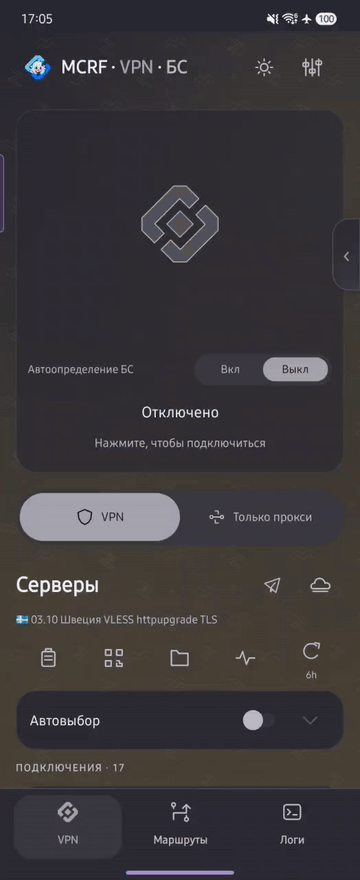 | 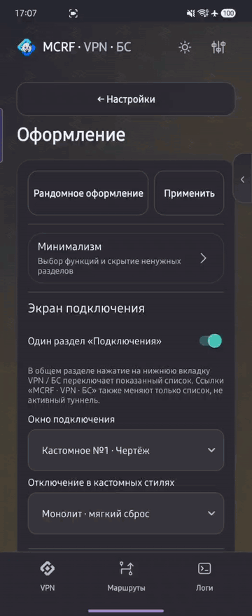 | 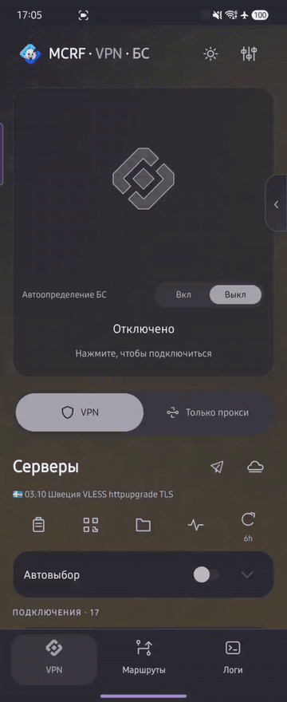 | 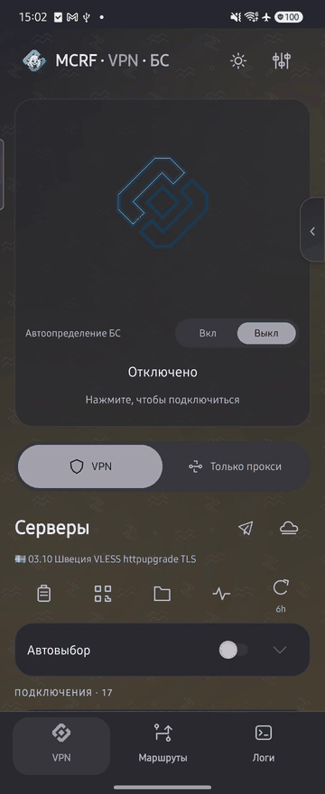 |

## Установка

Скачайте один универсальный APK приложения. Основные движки — sing-box, Steer и компактный WG/AWG — устанавливаются отдельно под архитектуру телефона из единого каталога. Если движка для сервера нет, приложение предложит загрузить нужный модуль. Android может попросить разрешить установку из MCRF; после этого подтвердите установку в системном окне. Проверки подписи и формата пакета не отключаются.

Для VPN потребуется системное разрешение. Обновляйте приложение поверх установленного, без удаления: так сохраняются защищённые данные.

## Подключение

Главная показывает текущий сервер и состояние соединения. Нажатие на область подключения запускает или останавливает VPN. Режим «Только прокси» создаёт локальный HTTP/SOCKS5-вход вместо туннеля всего телефона.

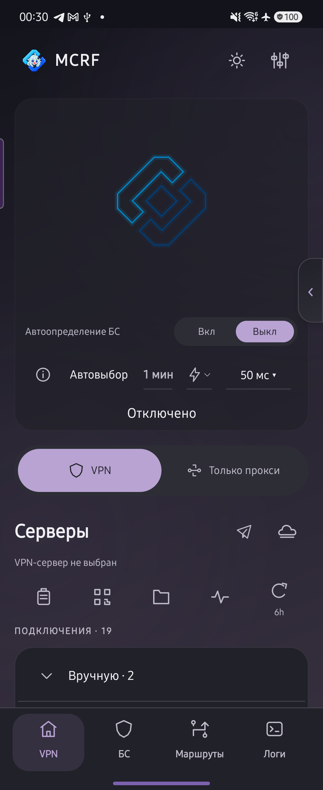

## Серверы и подписки

Подключения объединены в сворачиваемые группы. Для подписок доступны обновление по расписанию, переименование и изменение ссылки. Сервер можно выбрать, отредактировать, скопировать или передать QR-кодом. Импорт работает из буфера, файла и QR.

Автовыбор использует отмеченные серверы; задержка отображается рядом с каждым. В одной строке выбираются интервал, режим «Выключено / Самый быстрый / Последний» и допустимое отклонение. «При недоступности» не меняет исправно работающий сервер; небольшое отклонение может вызывать частые переключения и мешать потоковым приложениям.

Значок самолётика открывает Telegram с настройками локального WS-прокси, облака — создание WARP-подключения. Боковая панель даёт быстрый доступ к VPN, БС и Telegram WS.

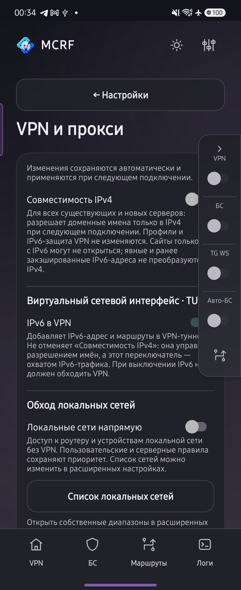

## БС и автопереключение

В БС собраны отдельные подключения для сетей с ограниченным доступом, включая TURN-транспорты и S3 Bypass. Для серверов с капчей доступен автоматический или ручной режим.

«Автоопределение БС» включается отдельно. При включённой функции доступность сети проверяется **до запуска VPN**, чтобы сразу выбрать нужный режим. Затем приложение проверяет сеть с настраиваемым интервалом и переключает VPN ↔ БС, уведомляя о переходе. Автовыбор сервера и автоопределение БС — разные настройки.

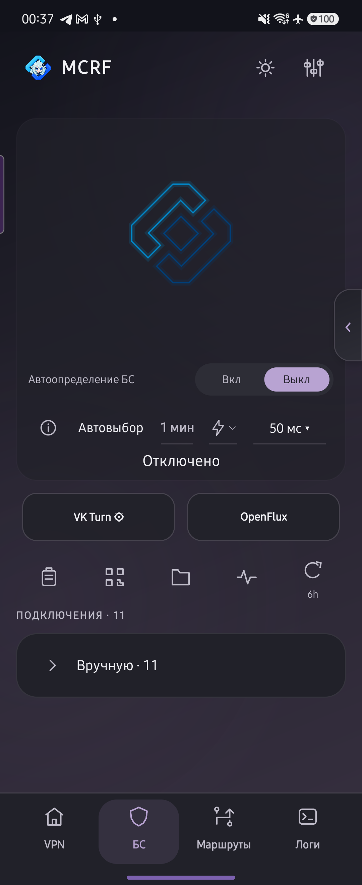

VPN и БС можно оставить разными вкладками или объединить в одну. В объединённом режиме повторное нажатие нижней вкладки меняет список; ссылки VPN/БС в заголовке переключают его напрямую.

## Маршруты

Правила применяются сверху вниз. У каждого списка есть действие: напрямую, VPN/прокси или блокировка. Условия задаются доменами, IP и приложениями; можно использовать исключения и отдельный DNS списка.

«Глобальные политики» задают приложения, которые всегда работают напрямую или через VPN. «Остальной трафик» определяет действие для запросов вне списков. Готовые пресеты содержат сервисные наборы; RU-app помогает выбрать российские приложения для прямого выхода.

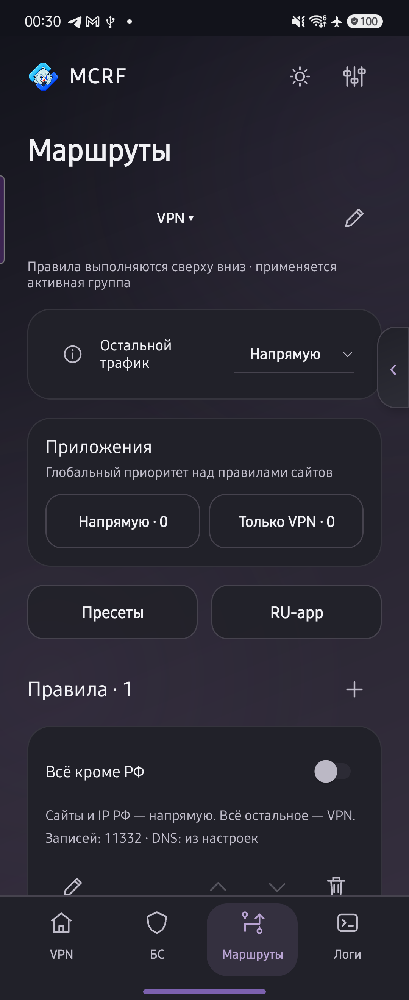 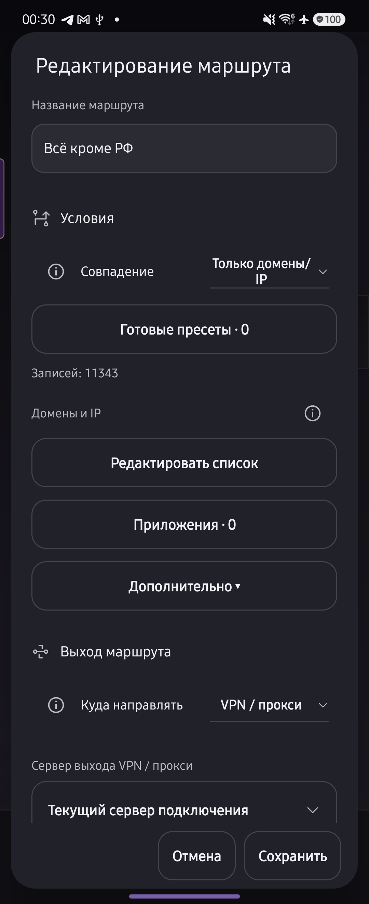

Крупные списки открываются отдельным редактором; в форме показывается количество записей. Выбор приложений поддерживает поиск и системные пакеты. Для каждого маршрута можно выбрать текущий сервер, отдельный сервер или группу серверов с поиском самого быстрого. Это отдельная настройка от трёх переименовываемых групп правил: VPN, БС и Авто VPN + БС. Применяется только активная группа правил.

## Vk Turn

В одном разделе находятся привязка аккаунта VK, режим капчи, ручные звонки и общие параметры TURN-транспортов. Списки хэшей свёрнуты; вставка удаляет дубли и показывает количество. Генерация звонков из привязанного профиля добавляет их в конец ручного списка. Опция «Дополнять для всех Turn-подключений» добавляет общие ручные хэши к серверным, без дублей.

Число потоков задаётся полосой с отметками отдельно для каждого транспорта. Доступный диапазон зависит от протокола и числа звонков; слишком большое число потоков повышает нагрузку. В поездке при частой смене вышек можно уменьшить потоки до 36 или ниже.

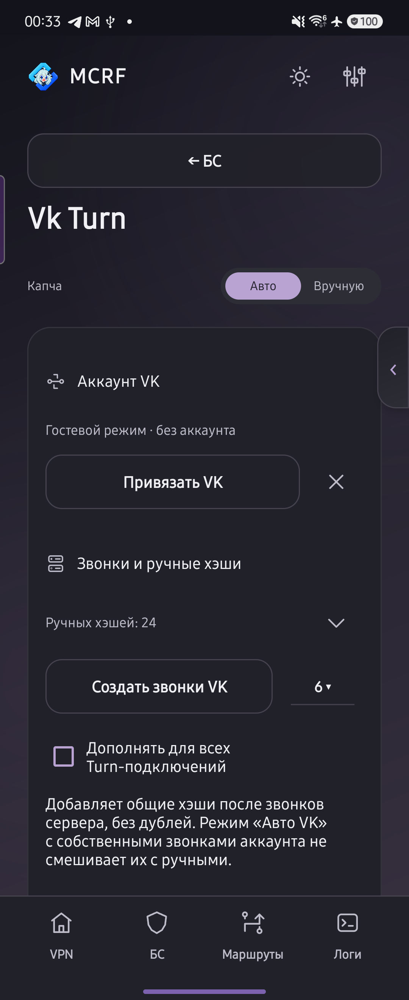 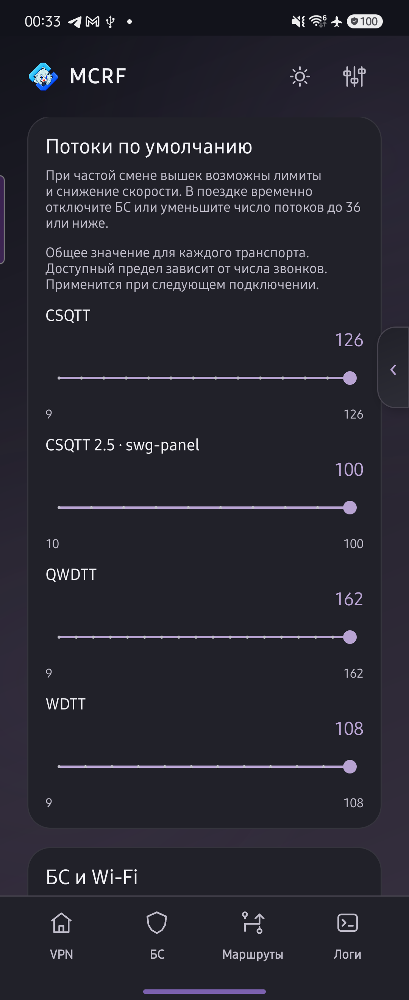

Поддержаны несовместимые поколения CSQTT 2.0, 2.1.5, 2.1.9 и 2.5, включая SWG Panel и Rebirth. Если версия в ссылке неоднозначна, импорт предлагает выбрать её явно. Модуль CSQTT 2.5 пока доступен только для arm64; остальные архитектуры — отдельный пункт П3.

## DNS и домены

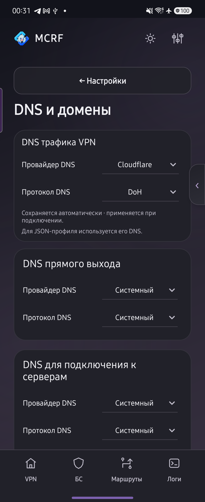

Параметры разделены по назначению:

| Группа | Что настраивает |
| --- | --- |
| DNS трафика VPN | Разрешение имён сайтов, направленных через VPN |
| DNS прямого выхода | Имена для прямых маршрутов; по умолчанию системный DNS |
| DNS для подключения к серверам | Адрес самого VPN-сервера до создания туннеля |
| DNS по умолчанию | Основной выбор для остальных DNS-запросов |
| Расширенные настройки | Редкие параметры DNS и сети |

DNS подключения к серверам нужен, например, чтобы получить IP для `vpn.example.org`, когда VPN ещё не запущен. Это не отдельный DNS всех сайтов.

Ссылки в расширенные настройки открывают нужную группу. Назад возвращает в исходный раздел.

## VPN и прокси

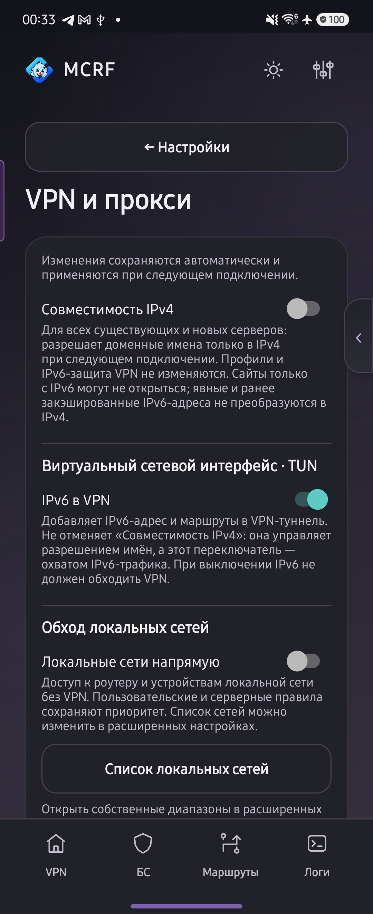

IPv6 включён по умолчанию. «Совместимость IPv4» выключена по умолчанию: при включении она меняет разрешение доменных имён для существующих и новых серверов, предпочитая IPv4.

«IPv6 в VPN» добавляет IPv6-адрес и маршруты в туннель. Это отдельная настройка, не синоним совместимости IPv4. Прямые маршруты и VPN-маршруты задаются в разделе «Маршруты».

Ниже находятся локальный HTTP/SOCKS5-прокси, авторизация и доступ из локальной сети. Логин и пароль копируются отдельными значками; значок обновления открывает смену реквизитов.

Для другого устройства откройте настройки точки доступа, разрешите доступ к прокси и укажите на клиенте адрес телефона, порт и авторизацию. Это раздача прокси, а не автоматический VPN для всех клиентов точки доступа.

## Оформление и скрытие разделов

Настраиваются цвета обеих тем, фоновые узоры, значок приложения и вид подключения. «Скрыть разделы» убирает ненужные функции; боковое меню настраивается отдельно. Рандомайзер выбирает сочетание оформления, включая дизайн подключения.

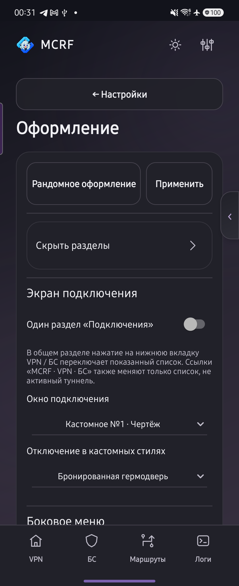

Классический стиль и семь промышленных анимаций: «Чертёж», паровой пресс, плазменный резак, магнитный разбор, токарный станок, литейная форма и робот-сварщик. Для подходящих стилей отключение выбирается отдельно; бронированная гермодверь — один из вариантов.

Подключённый ромб пульсирует заливкой. В «Чертёже» декоративная струя постоянная. Вес этого стиля в рандомайзере — в 2,5 раза выше каждого другого.

## Оптимизация расхода батареи и фонового трафика

Настройки находятся в «Оформление → Статистика в уведомлении». По умолчанию счётчики обновляются раз в **3 секунды** с открытым приложением и раз в **10 секунд** в фоне. При выключенном экране опрос остановлен; после пробуждения данные обновляются. Интервалы можно изменить, а счётчики — полностью отключить: тогда уведомление показывает только подключение к серверу.

Частое обновление увеличивает расход батареи. Сокращены лишние фоновые обновления и перерисовки; срок хранения логов ограничивается. Оптимизация расхода батареи включена в 0.6; автодеплой и управление VPS описаны отдельно ниже.

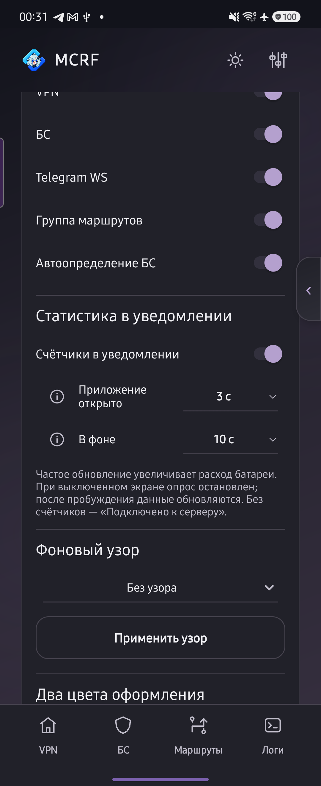

## Настройки

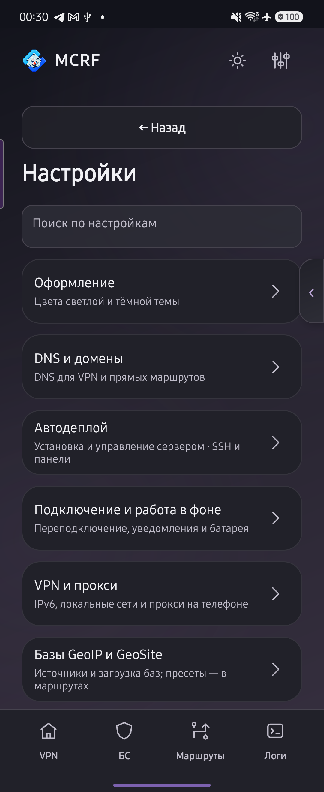

Поиск ведёт к нужному параметру, включая расширенные группы. Часто используемые настройки вынесены на отдельные страницы:

- **Подключение и работа в фоне:** восстановление соединения, уведомления, поведение в недавних и настройки батареи.
- **Базы GeoIP и GeoSite:** источники, загрузка наборов и применение в маршрутах.
- **Обновления и движки:** версия приложения, основной движок и дополнительные модули.
- **Резервные копии:** локальное сохранение и WebDAV.
- **Расширенные настройки:** TLS, транспорт, TUN, DNS и редкие параметры; сброс выполняется отдельно для каждой группы.

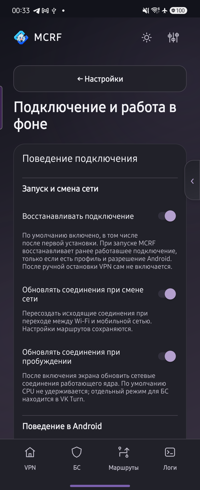

## Движки и обновления

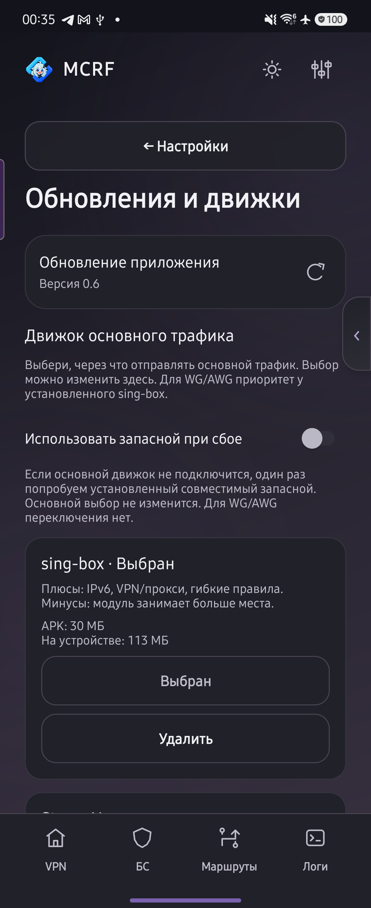 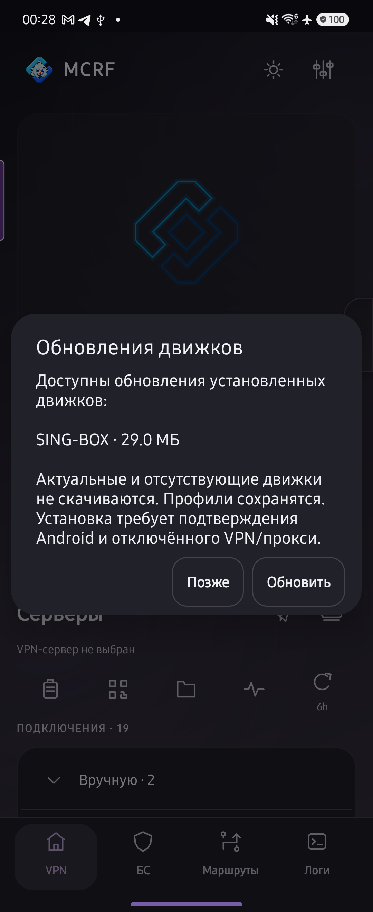

| Основной движок | Назначение |
| --- | --- |
| sing-box — кастомная сборка MCRF на базе sing-box-lx | Широкий набор протоколов, маршрутизация, DNS и IPv6 |
| Steer — доработанный порт MCRF | Компактный движок, правила, DNS, IPv6 и авторизованный HTTP/SOCKS5 |
| Компактный WG/AWG — собственный модуль MCRF на wireguard-go | WireGuard и AmneziaWG 3.0/3.1, IP-правила, блокировка и DNS |

Основной движок выбирается в приложении. Для WG/AWG установленный sing-box имеет приоритет перед компактным модулем; выбор для остальных подключений не меняется.

Дополнительный пул содержит CSQTT, WDTT, QWDTT, OLCRTC, DNSTT, Telegram WS, Xray/TLS и WARP Scanner. Это сторонние проекты с интеграцией MCRF. [Ссылки на движки и их происхождение](../README.md#скачать).

Приложение и модули обновляются отдельно. Подходящий пакет подбирается по архитектуре телефона; уже актуальный модуль повторно скачивать не нужно.

## WARP и Telegram WS

WARP создаёт подключение WireGuard/AWG и позволяет искать выход по стране. Успешный результат сохраняется в списке серверов. Настройки поиска находятся в том же окне; сканер обновляется отдельным модулем.

Telegram WS запускает локальный прокси для Telegram. Боковой переключатель включает сервис с других страниц; значок самолётика открывает Telegram для использования прокси.

## Автодеплой

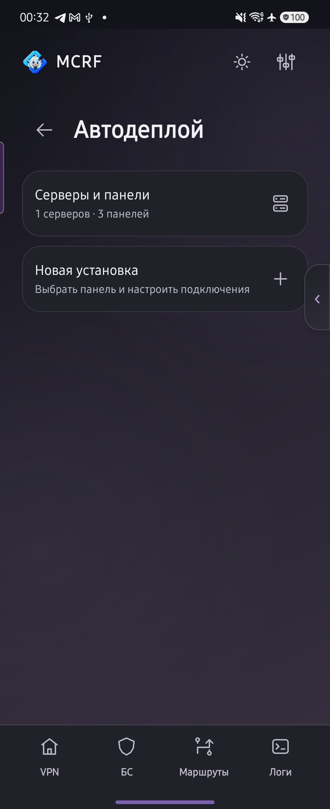 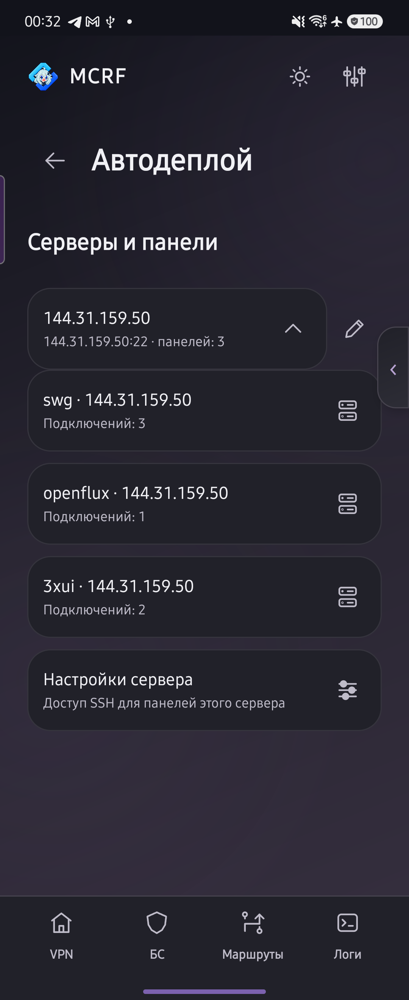

№57 выполнен в П2: автодеплой сохраняет **серверы, панели и подключения**, а не только полученные ссылки. Поддержаны 3x-ui, SWG Panel и OpenFlux; можно создать несколько именованных установок одного протокола на одном или разных серверах. SWG Panel — 1.8.10-beta, с отдельным выбором поколений CSQTT.

Нажатие на сервер раскрывает его панели на месте; настройки SSH общие для панелей этого сервера. Нажатие на панель открывает отдельную страницу действий. «Добавить подключение» показывает короткий выбор протокола, без повторного ввода всех серверных параметров. S3 Bypass и дальнейшее расширение управления остаются отдельными будущими задачами.

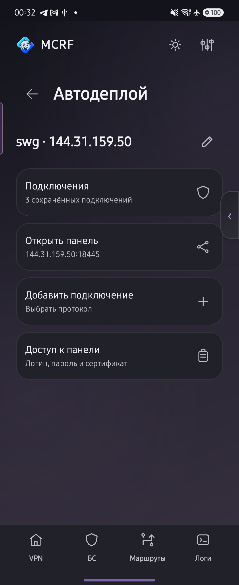

## Логи

Обычная таблица показывает время, тип и событие. Кнопка «Терминал» меняет представление; рядом выбирается срок хранения: 5, 15, 30, 60 минут, 3 часа или сутки. По умолчанию — последний час. Фильтр помогает оставить нужные события, а копирование собирает отчёт для разбора проблемы.

[Полный пул реализации и приоритеты](../README.md#пул-реализации-android).
