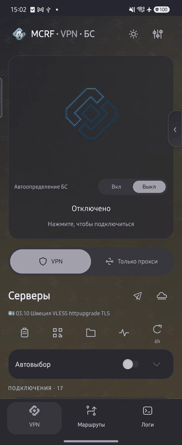
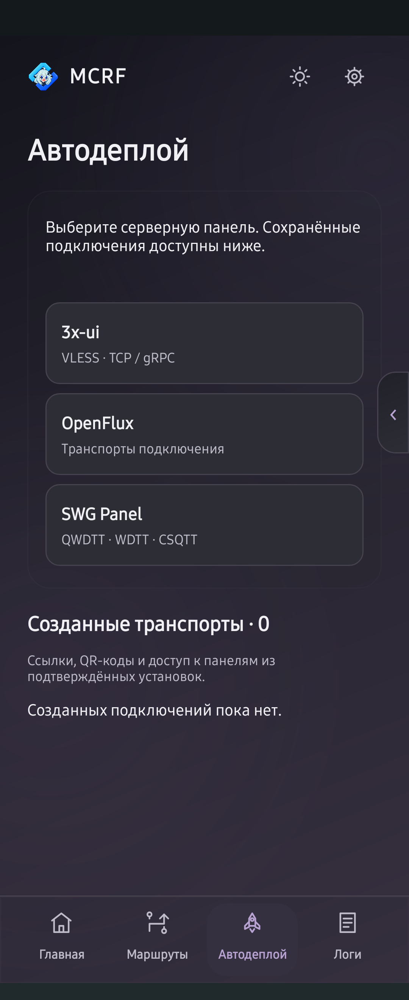

# MCRF Android

Тестовый Android-клиент для серверов, подписок, VPN/прокси и маршрутизации. Возможности зависят от выбранного основного движка и установленных дополнений.

Запись настоящего приложения на Samsung с существующим каталогом: реальное подключение и отключение VPN, разделы и смена светлого/тёмного оформления. Серверы не подменены демонстрационными. Ключи, пароли и QR-коды в запись не включены.

## Установка и первый запуск

1. Скачайте APK из [Android-пререлиза 0.1.0-preview.20261020.1](https://github.com/vnenapravo7-source/mcrf/releases/tag/android-v0.1.0-preview.20261020.1): обычно нужен `arm64-v8a`; есть также `armeabi-v7a`, `x86_64` и универсальное приложение.
2. Выберите основной движок. sing-box, Steer и компактный WG устанавливаются отдельными APK. Актуальные тестовые модули приложены к этому же пререлизу; остальные — в [общем каталоге движков](https://github.com/vnenapravo7-source/mcrf/releases/tag/engines-2026-10-13-1). Для Steer нет `armeabi-v7a`.
3. Подтвердите установку модуля в Android и импортируйте свой сервер или подписку.
4. Для режима VPN дайте системное разрешение. Для стабильной фоновой работы проверьте уведомления и ограничения батареи.

Пакеты проверяются по SHA-256, подписи, идентификатору и архитектуре. Тестовые APK используют текущую подпись разработки; не удаляйте приложение для обновления поверх совместимой версии — это может уничтожить его данные.

## Главная и серверы

Подключения сгруппированы по подпискам; вручную добавленные серверы находятся в отдельной группе. Группы сворачиваются. Доступны импорт ссылок/файлов/QR, обновление подписок и измерение задержки.

Режим VPN захватывает трафик через системный туннель. «Только прокси» предоставляет локальный HTTP/SOCKS5-вход для приложений, в которых настроен прокси; он не равен VPN всего телефона. В пакете П1 авторизованные локальные HTTP/SOCKS5 для Steer проверены отдельно от VPN; это не заявление о готовности всех сценариев LAN-раздачи.

Боковое управление VPN и Telegram WS можно скрывать свайпом. Автовыбор серверов зависит от возможностей движка. Автоопределение БС — отдельная выключаемая функция с проверкой раз в минуту и уведомлениями о подтверждённом переключении. Предварительная проверка БС до запуска VPN подготовлена, но фактическая приёмка этого сценария ещё не завершена.

## Оформление и анимации

Доступны классический вид и семь промышленных стилей, включая «Чертёж», паровой пресс, плазменный резак и магнитный разбор. Отдельно настраивается отключение, в том числе бронированная гермодверь; у части стилей собственный сценарий выхода. Подключённый ромб пульсирует заливкой. В «Чертёже» декоративная струя постоянная и не измеряет скорость сети.

Светлая/тёмная тема, цвета, узоры, значок приложения и дизайн подключения участвуют в оформлении. В рандомайзере вес «Чертежа» в 2,5 раза выше каждого другого варианта. VPN и БС можно объединить в один нижний раздел; повторное нажатие на него переключает представление, ссылки VPN/БС также доступны в заголовке.

## Основные движки

| Движок | Для чего | Ограничения текущей версии |
| --- | --- | --- |
| sing-box | Широкий набор VPN/прокси-протоколов, IPv6, DNS и гибкие правила | Более крупный отдельный пакет |
| Steer | Компактный независимый основной движок | В П1 проверены поддерживаемые правила/DNS, IPv6 и авторизованный локальный HTTP/SOCKS5; это не полный набор sing-box |
| Компактный WG/AWG | WireGuard, AWG 3.0/3.1 без полного sing-box | В П1 проверены IP/BLOCK и управляемый DNS; произвольные правила и провайдеры не считаются автоматически поддержанными |

Если установлены оба движка, перед первым подключением нужно подтвердить основной. Его можно поменять в меню движков. Для WG/AWG приоритет имеет установленный sing-box; это не меняет основной выбор для остальных подключений.

«Использовать запасной при сбое» — отдельная настройка. Полная проверка аварийного переключения ещё продолжается. Назначение разных серверов отдельным правилам разрабатывается в П2 и не входит в этот пререлиз. Поддерживаемый пакет П1 прошёл контролируемые проверки на Samsung, но это не универсальная приёмка каждого сервера, сети или телефона.

## Маршруты и DNS

Правила задаются для доменов, IP и Android-приложений. Основные действия: напрямую, VPN/прокси и блокировка. Порядок правил имеет значение.

Готовые сервисные списки и GeoIP/GeoSite собраны в общем выборе с поиском. GeoIP предлагается для РФ; GeoSite — для категорий и сервисов. Отметьте нужные пункты и выберите действие — появятся управляемые маршруты.

В «DNS и домены» отдельно сгруппированы DNS трафика VPN, прямого выхода, подключения к серверам и DNS по умолчанию. Для прямого выхода по умолчанию используется системный DNS. DNS подключения к серверам нужен для разрешения имени самого VPN-сервера до установления туннеля — это не DNS всего трафика. Дополнительные параметры находятся в «Расширенных настройках»; ссылки ведут к нужной группе с возвратом в исходный раздел.

IPv6 по умолчанию разрешён. «Совместимость IPv4» в «VPN и прокси» выключена по умолчанию и применяется к существующим и новым подключениям. Ограничения конкретного движка не должны молча превращать правило VPN в прямой выход.

## WARP

Создание WARP-подключения открывается с главной. Есть выбор WireGuard/AWG, поиск выхода вне РФ или в РФ и расширенный список стран. Поиск проверяет реальное подключение, а не только доступность адреса; скорость зависит от сети.

Успешный результат сохраняется как сервер. WARP Scanner обновляется отдельно от приложения. Поиск может завершиться ошибкой, если подходящий рабочий выход не найден.

## Дополнительные транспорты

CSQTT, WDTT, QWDTT, OLCRTC и DNSTT требуют отдельных модулей и подходящих серверных настроек. Telegram WS, Xray/TLS и WARP Scanner также поставляются отдельно.

OpenFlux можно скачать, но рабочий HTTPS-трафик Android пока не подтверждён. Его доработка отложена; наличие пакета в каталоге не означает готовность транспорта.

## Автодеплой

Доступны формы 3x-ui, SWG и OpenFlux. Для SSH выбирается пароль **или** ключ; поля создания подключения появляются по необходимости.

«Созданные транспорты» предназначены для сохранённых результатов установки: ссылок подключения, QR и доступа к панели. Не запускайте полный деплой только ради просмотра ссылки. Проверка реального развёртывания всех вариантов ещё продолжается.

## Раздача другим устройствам

Раздел предоставляет HTTP/SOCKS5-прокси через телефон: локальные адреса, порт и обязательную авторизацию. Другое устройство должно быть в доступной локальной сети и использовать эти реквизиты.

Это **не** прозрачная раздача VPN всем клиентам точки доступа. Системная кнопка открывает настройки точки доступа Android; VPN телефона должен оставаться подключённым.

## Настройки, обновления и данные

Обычные страницы разделены на DNS, поведение подключения, VPN/локальный прокси, раздачу и другие понятные группы. Редкие сетевые параметры находятся в «Расширенных настройках»; существующие значения сохраняются.

Обновления приложения и модулей различаются. Одинаковая версия приложения не должна предлагаться повторно; конкретную версию можно пропустить. Отдельные движки разных платформ размещаются в общем фиксированном каталоге, без нового релиза каталога на каждое обновление.

Профили и локальные резервные копии содержат чувствительные данные. Не публикуйте ссылки с ключами, пароли и полные резервные копии вместе с отчётом об ошибке.

## Статус

Android остаётся тестовой версией. Проверка интерфейса, скачивания APK или отдельного протокола не заменяет проверку всех сетей, устройств, архитектур, фоновых режимов и миграций.
