# MCRF Android

[Скачать](https://github.com/vnenapravo7-source/mcrf/releases/tag/android-v0.1.0-preview.20261020.1) · [Движки](../README.md#скачать) · [План доработок](../README.md#пул-реализации-android)

VPN, белые списки, Telegram WS и маршрутизация в одном приложении для Android 10+.

## Установка

Скачайте универсальный APK или вариант своей архитектуры. Основные движки — sing-box, Steer и компактный WG/AWG — устанавливаются отдельно. Если движка для сервера нет, приложение предложит загрузить нужный модуль. Подтвердите установку в системном окне Android.

Для VPN потребуется системное разрешение. Обновляйте приложение поверх установленного, без удаления: так сохраняются защищённые данные.

## Подключение

Главная показывает текущий сервер и состояние соединения. Нажатие на область подключения запускает или останавливает VPN. Режим «Только прокси» создаёт локальный HTTP/SOCKS5-вход вместо туннеля всего телефона.

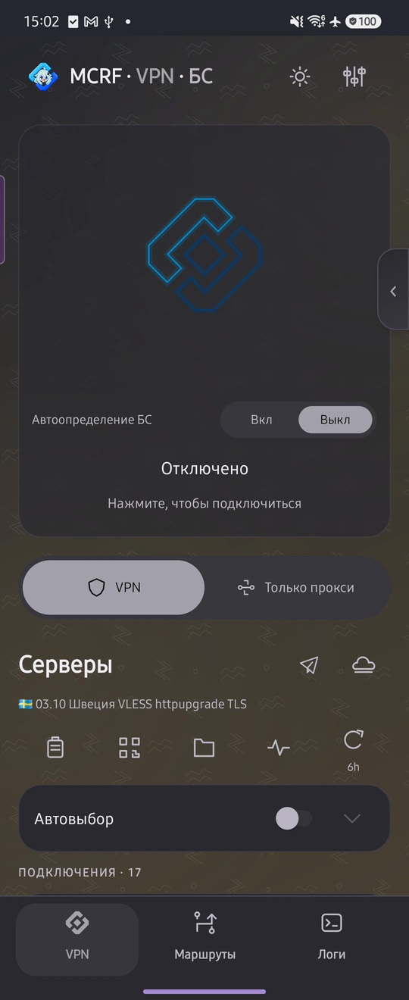 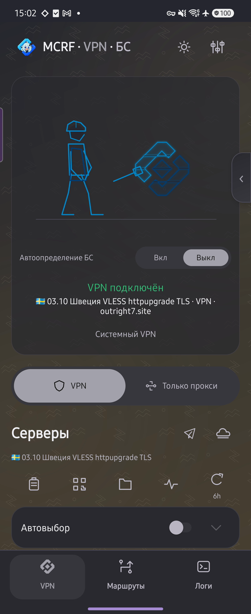

## Серверы и подписки

Подключения объединены в сворачиваемые группы. Для подписок доступны обновление по расписанию, переименование и изменение ссылки. Сервер можно выбрать, отредактировать, скопировать или передать QR-кодом. Импорт работает из буфера, файла и QR.

Автовыбор использует отмеченные серверы; задержка отображается рядом с каждым. Настройки интервала и порога переключения находятся внутри блока автовыбора.

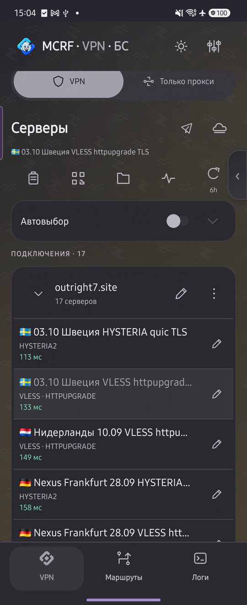

Значок самолётика открывает Telegram с настройками локального WS-прокси, облака — создание WARP-подключения. Боковая панель даёт быстрый доступ к VPN, БС и Telegram WS.

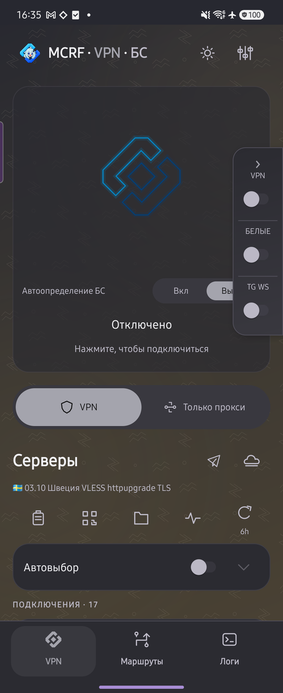

## Белые списки и автопереключение

В БС собраны отдельные подключения для сетей с ограниченным доступом, включая TURN-транспорты и S3 Bypass. Для серверов с капчей доступен автоматический или ручной режим.

«Автоопределение БС» включается отдельно. Приложение регулярно, раз в минуту, проверяет доступность сети и переключает VPN ↔ БС, уведомляя о переходе. Автовыбор сервера и автоопределение БС — разные настройки.

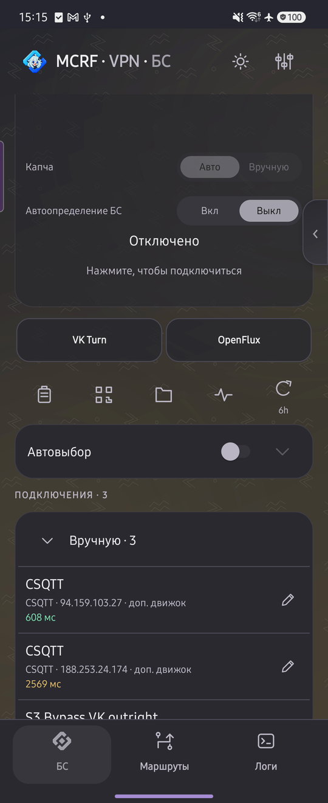

VPN и БС можно оставить разными вкладками или объединить в одну. В объединённом режиме повторное нажатие нижней вкладки меняет список; ссылки VPN/БС в заголовке переключают его напрямую.

## Маршруты

Правила применяются сверху вниз. У каждого списка есть действие: напрямую, VPN/прокси или блокировка. Условия задаются доменами, IP и приложениями; можно использовать исключения и отдельный DNS списка.

«Глобальные политики» задают приложения, которые всегда работают напрямую или через VPN. «Остальной трафик» определяет действие для запросов вне списков. Готовые пресеты содержат сервисные наборы; RU-app помогает выбрать российские приложения для прямого выхода.

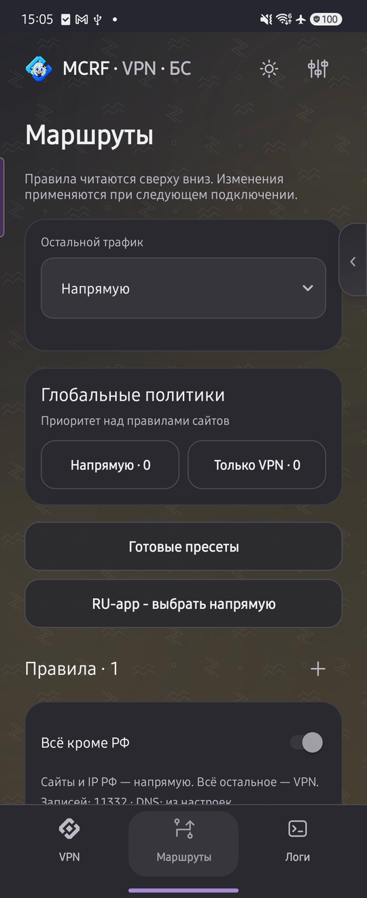 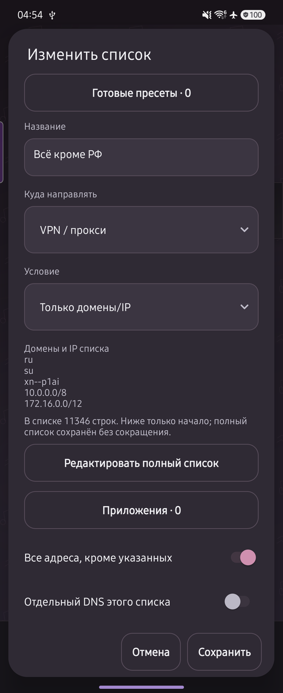

Крупные списки открываются отдельным редактором. Выбор приложений поддерживает поиск и отображение системных пакетов. Назначение отдельного сервера каждому правилу находится в текущем плане П2.

## DNS и домены

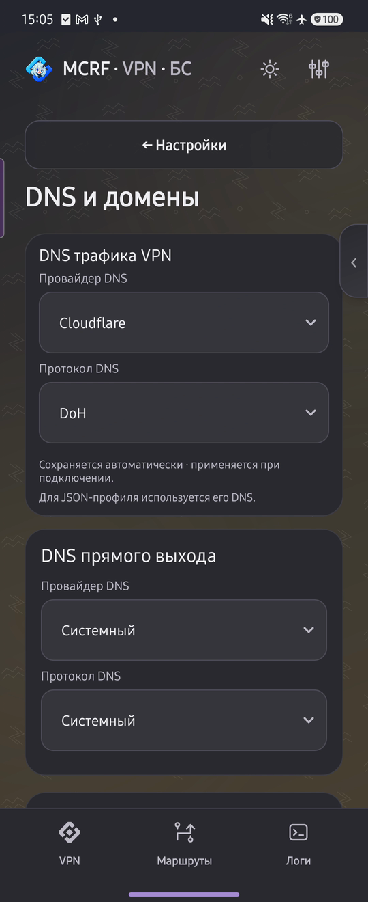

Параметры разделены по назначению:

| Группа | Что настраивает |
| --- | --- |
| DNS трафика VPN | Разрешение имён сайтов, направленных через VPN |
| DNS прямого выхода | Имена для прямых маршрутов; по умолчанию системный DNS |
| DNS для подключения к серверам | Адрес самого VPN-сервера до создания туннеля |
| DNS по умолчанию | Основной выбор для остальных DNS-запросов |
| Расширенные настройки | Редкие параметры DNS и сети |

DNS подключения к серверам нужен, например, чтобы получить IP для `vpn.example.org`, когда VPN ещё не запущен. Это не отдельный DNS всех сайтов.

Ссылки в расширенные настройки открывают нужную группу. Назад возвращает в исходный раздел.

## VPN и прокси

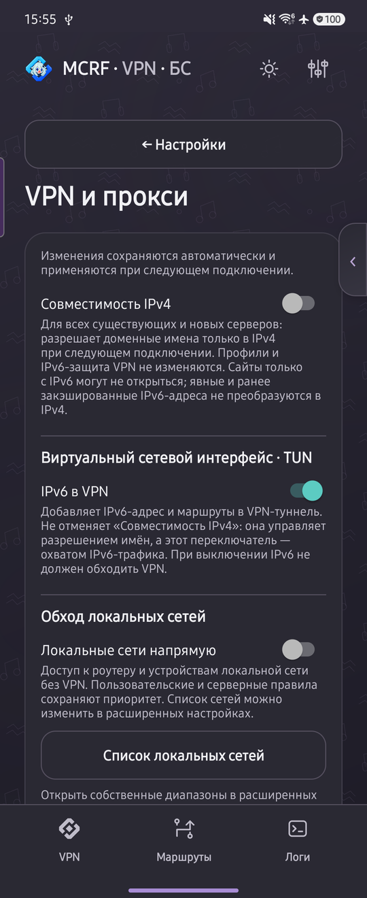

IPv6 включён по умолчанию. «Совместимость IPv4» выключена по умолчанию: при включении она меняет разрешение доменных имён для существующих и новых серверов, предпочитая IPv4.

«IPv6 в VPN» добавляет IPv6-адрес и маршруты в туннель. Это отдельная настройка, не синоним совместимости IPv4. Прямые маршруты и VPN-маршруты задаются в разделе «Маршруты».

Ниже находятся локальный HTTP/SOCKS5-прокси, авторизация и доступ из локальной сети. Логин и пароль копируются отдельными значками; значок обновления открывает смену реквизитов.

Для другого устройства откройте настройки точки доступа, разрешите доступ к прокси и укажите на клиенте адрес телефона, порт и авторизацию. Это раздача прокси, а не автоматический VPN для всех клиентов точки доступа.

## Оформление и минимализм

Настраиваются цвета обеих тем, фоновые узоры, значок приложения и вид подключения. Минимализм скрывает ненужные функции и разделы. Рандомайзер выбирает сочетание оформления, включая дизайн подключения.

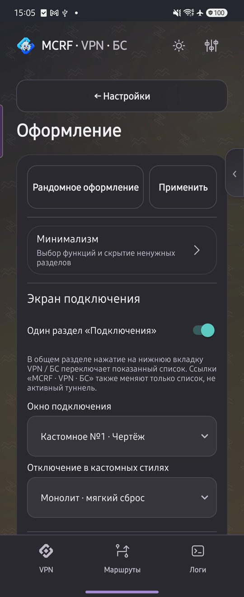 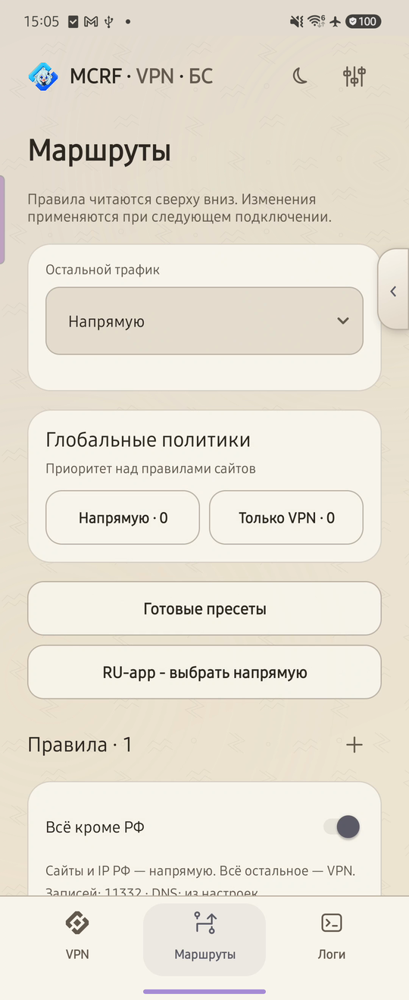

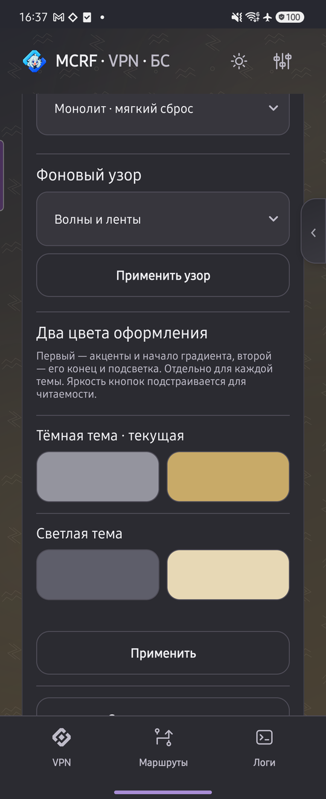 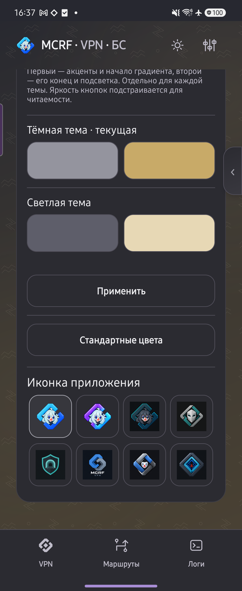

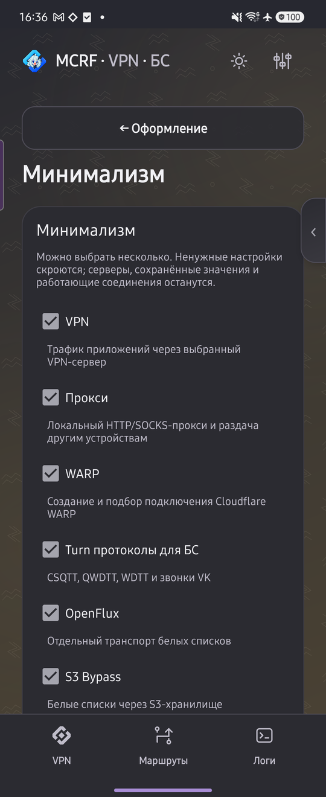

Классический стиль и семь промышленных анимаций: «Чертёж», паровой пресс, плазменный резак, магнитный разбор, токарный станок, литейная форма и робот-сварщик. Для подходящих стилей отключение выбирается отдельно; бронированная гермодверь — один из вариантов.

Подключённый ромб пульсирует заливкой. В «Чертёже» декоративная струя постоянная. Вес этого стиля в рандомайзере — в 2,5 раза выше каждого другого.

## Настройки

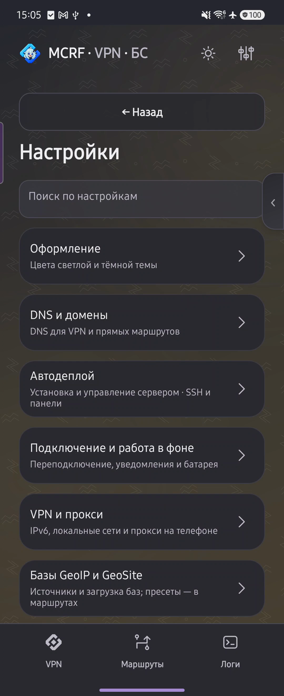

Поиск ведёт к нужному параметру, включая расширенные группы. Часто используемые настройки вынесены на отдельные страницы:

- **Подключение и работа в фоне:** восстановление соединения, уведомления, поведение в недавних и настройки батареи.
- **Базы GeoIP и GeoSite:** источники, загрузка наборов и применение в маршрутах.
- **Обновления и движки:** версия приложения, основной движок и дополнительные модули.
- **Резервные копии:** локальное сохранение и WebDAV.
- **Расширенные настройки:** TLS, транспорт, TUN, DNS и редкие параметры; сброс выполняется отдельно для каждой группы.

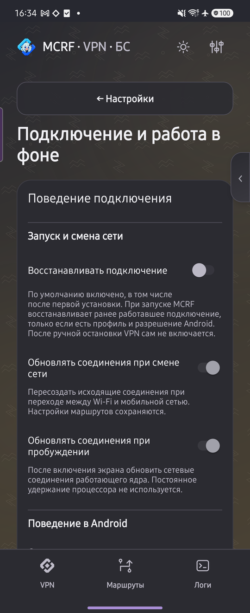 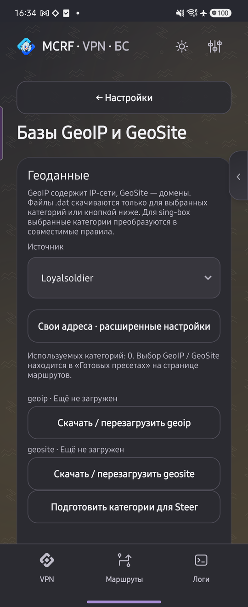

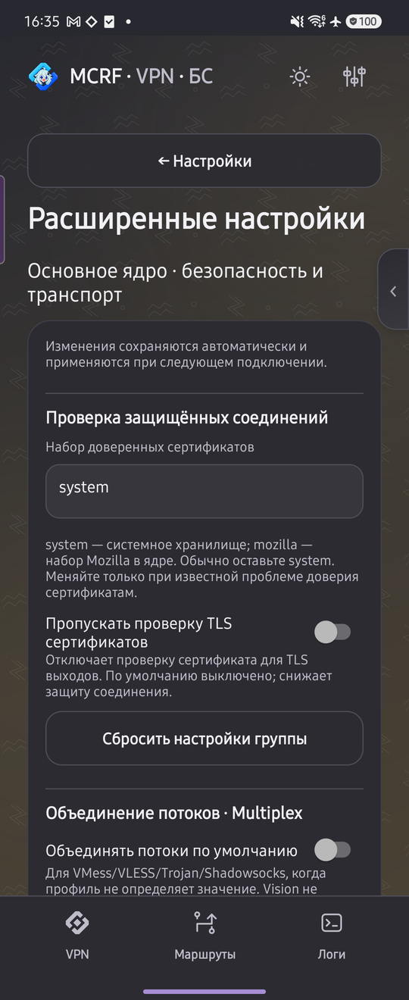

## Движки и обновления

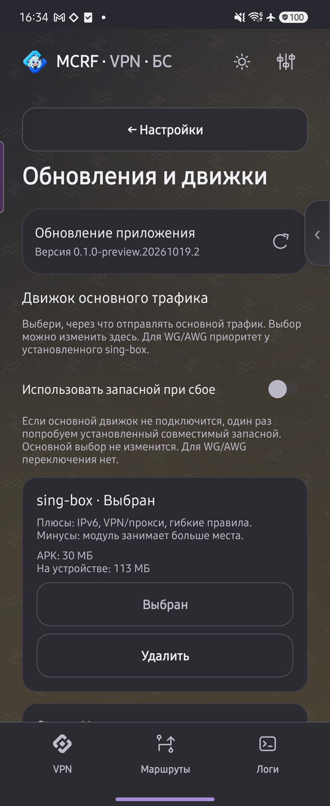

| Основной движок | Назначение |
| --- | --- |
| sing-box — кастомная сборка MCRF на базе sing-box-lx | Широкий набор протоколов, маршрутизация, DNS и IPv6 |
| Steer — доработанный порт MCRF | Компактный движок, правила, DNS, IPv6 и авторизованный HTTP/SOCKS5 |
| Компактный WG/AWG — собственный модуль MCRF на wireguard-go | WireGuard и AmneziaWG 3.0/3.1, IP-правила, блокировка и DNS |

Основной движок выбирается в приложении. Для WG/AWG установленный sing-box имеет приоритет перед компактным модулем; выбор для остальных подключений не меняется.

Дополнительный пул содержит CSQTT, WDTT, QWDTT, OLCRTC, DNSTT, Telegram WS, Xray/TLS и WARP Scanner. Это сторонние проекты с интеграцией MCRF. [Ссылки на движки и их происхождение](../README.md#скачать).

Приложение и модули обновляются отдельно. Подходящий пакет подбирается по архитектуре телефона; уже актуальный модуль повторно скачивать не нужно.

## WARP и Telegram WS

WARP создаёт подключение WireGuard/AWG и позволяет искать выход по стране. Успешный результат сохраняется в списке серверов. Настройки поиска находятся в том же окне; сканер обновляется отдельным модулем.

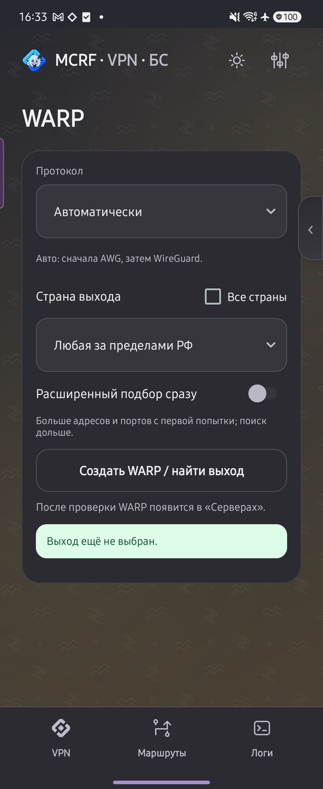

Telegram WS запускает локальный прокси для Telegram. Боковой переключатель включает сервис с других страниц; значок самолётика открывает Telegram для использования прокси.

## Автодеплой

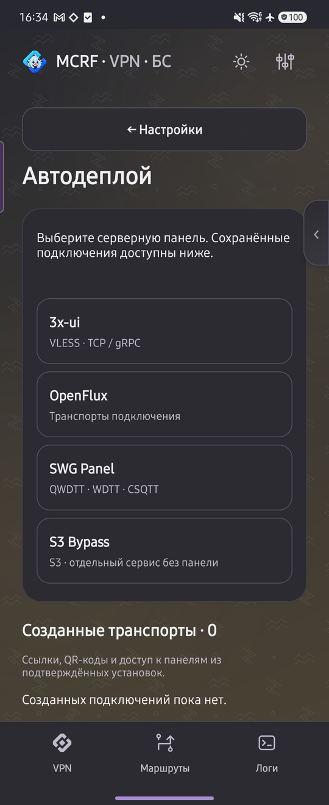

Формы 3x-ui, SWG и других панелей собирают параметры SSH и будущего подключения. В «Созданных транспортах» сохраняются ссылки, QR и доступ к панели. Доработка развёртывания и управления серверами находится в П4.

## Логи

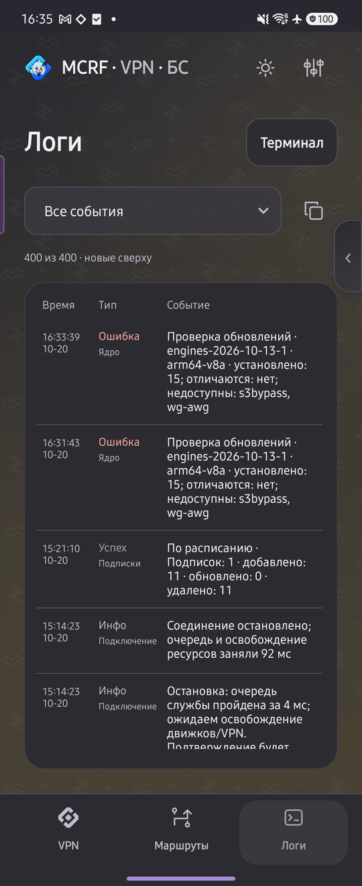

Обычная таблица показывает время, тип и событие. Кнопка «Терминал» меняет представление; фильтр помогает оставить нужные события. Копирование собирает отчёт для разбора проблемы.

## Короткий обзор

**Функции:** БС, серверы, правила и DNS.

**Разделы:** VPN, БС, маршруты, настройки, DNS и оформление.

[Полный пул реализации и приоритеты](../README.md#пул-реализации-android).
