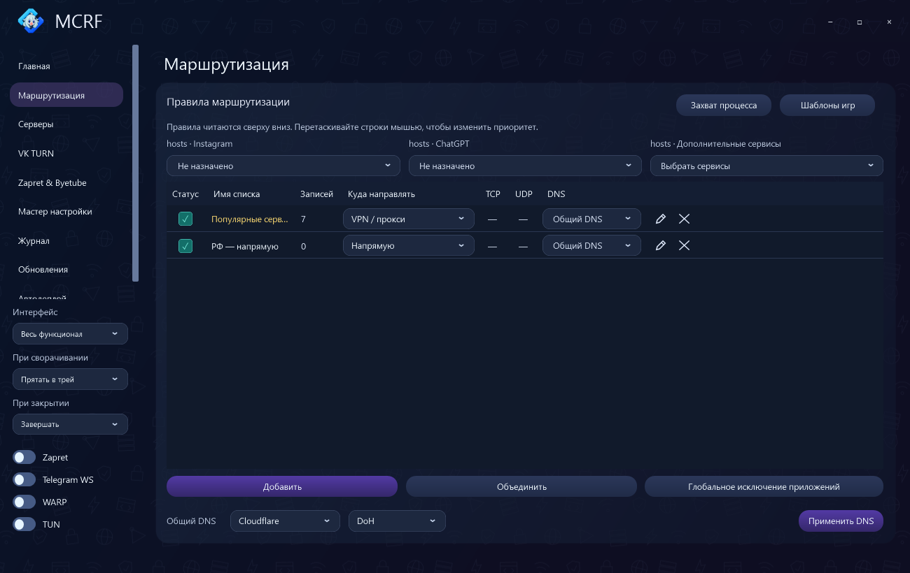
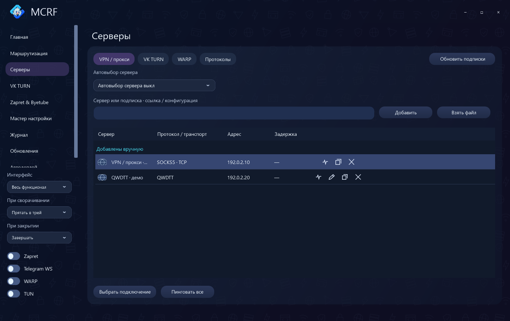
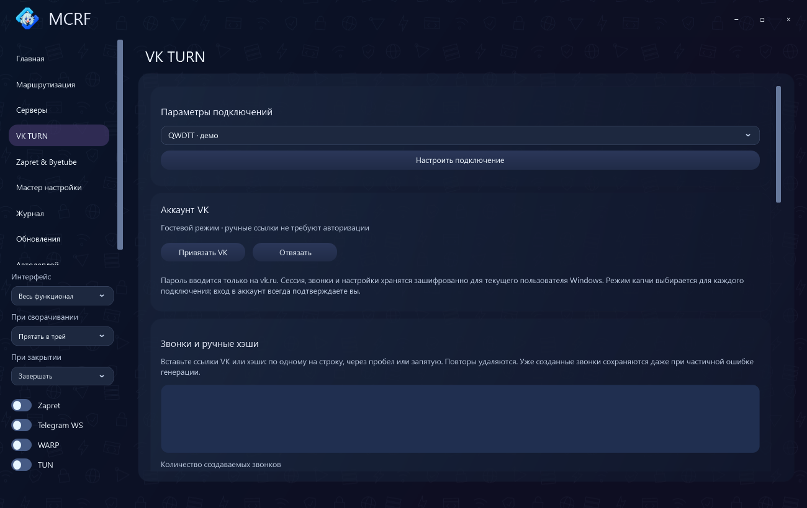
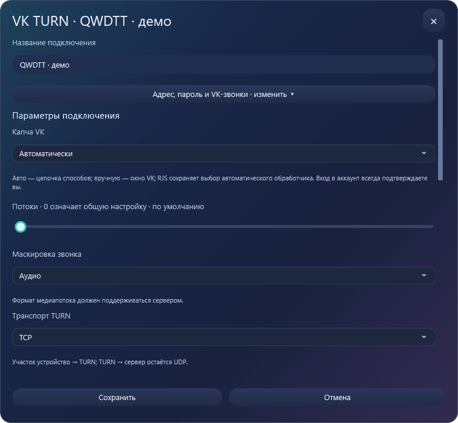
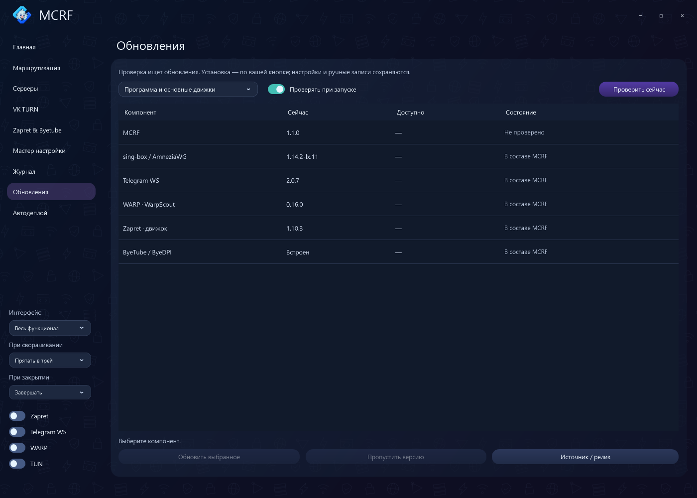
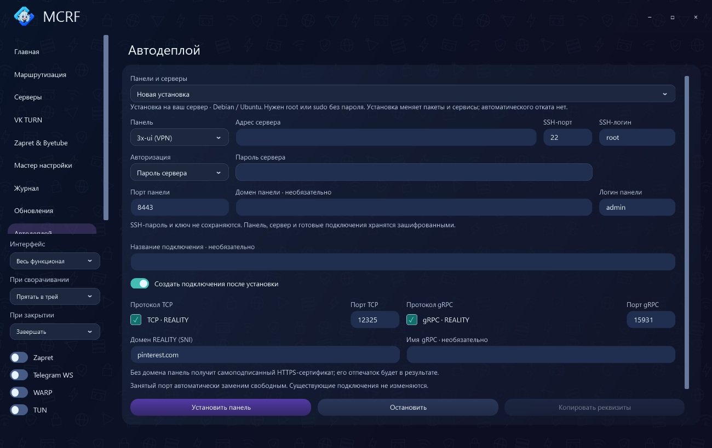

# MCRF для Windows

[Скачать 1.1.1](https://github.com/vnenapravo7-source/mcrf/releases/download/v1.1.1/mcrf.exe) · [Изменения](releases/1.1.1.md) · [Исходники 1.1.1](https://github.com/vnenapravo7-source/mcrf/releases/download/v1.1.1/mcrf-1.1.1-source.zip)

Windows x64, .NET Framework 4.8. Для встроенного входа VK нужен WebView2 Runtime. Программа — один `mcrf.exe`, который можно переименовать. Дополнительные движки скачиваются по необходимости с проверкой SHA-256. Контрольные суммы приложения и исходников — в `SHA256SUMS.txt` выпуска.

## Интерфейс и поведение окна

Внизу боковой панели — список «Интерфейс»: **Весь функционал** или **Только VPN**. Выбор запоминается. Во втором режиме остаются серверы с управлением подключением, конструктор, обновления VPN-компонентов и TUN; главная и WARP скрыты.

Здесь же выбирается действие при сворачивании — трей или панель задач — и при закрытии: трей или завершение.

## Главная

VPN, Zapret, WARP и Telegram WS; выбор сервера и автовыбор, время подключения, скорость, события. TUN направляет трафик через виртуальный адаптер, локальный режим предоставляет HTTP/SOCKS5-прокси. Автозапуск, горячие клавиши, резервная копия, восстановление и сброс профиля.

## Маршрутизация

Правила для доменов, IP и приложений. Выходы: VPN/прокси, напрямую, блокировка, Telegram WS, WARP, Zapret и ByeTube. Приоритет меняется перетаскиванием; доступны общий DNS и отдельный DNS правила.

Готовые пресеты, объединение списков, глобальные исключения, захват адресов процесса и игровые шаблоны с TCP/UDP. Списки запущенных процессов обновляются кнопкой в захвате, редакторе правила и глобальных исключениях. Записи hosts для Instagram, ChatGPT и других сервисов задаются над таблицей.

## Серверы

- **VPN / прокси:** импорт ссылок, файлов и подписок, обновление подписок, пинг, выбор сервера и автовыбор, копирование подключения. В режиме «Только VPN» управление подключением находится сверху этого раздела.
- **VK TURN:** параметры аккаунта и отдельных подключений.
- **WARP:** профили Cloudflare, выбор страны и WireGuard/AmneziaWG, подбор адреса и удаление профиля. Доступен в полном интерфейсе.
- **Протоколы:** возможности движков и состояние их установки.

Поддерживаются VLESS/REALITY, VMess, Trojan, Shadowsocks, Hysteria/2, TUIC, AnyTLS, NaiveProxy, SSH, HTTP/SOCKS5, WireGuard/AmneziaWG и дополнительные OpenFlux/CSQTT/WDTT/QWDTT.

## VK TURN

Выбор и редактирование подключения, вход VK, звонки, режим капчи и потоки. Для готовых ссылок звонков вход в VK не нужен. Параметры можно задать отдельно каждому серверу; локальные настройки сохраняются при обновлении подписки.

- **CSQTT:** поколения 2.0, 2.1.5, SWG 2.1 / WIRE-3 и SWG 2.5.1 / Rebirth. Для старых ссылок без версии доступен выбор поколения. Маскировка, TLS-отпечаток, получение TURN-данных, TCP/UDP и параметры устройства — по возможностям выбранного поколения.
- **CSQTT 2.5:** точное число потоков, перераспределение звонков, свои TURN IP, client IDs, generation/salt и выбор реализации.
- **WDTT:** маскировка, TLS, MASQUE/SNI, preflight, stream-first, client IDs и собственные данные VK-клиента.
- **QWDTT:** RAW/WireGuard, отдельный RAW-порт, DNS, TURN-транспорт, маскировка, TLS и способ авторизации.

Пояснения находятся рядом с настройками. Импорт и экспорт профиля MCRF сохраняет параметры подключения; экспортируемая ссылка содержит его данные доступа. Движки загружаются отдельно; общий локальный компонент CSQTT не требует установки WDTT.

## Zapret & ByeTube

Профили Zapret: имя, стратегия, включение, пресеты и горячие клавиши. Доступны стратегии Flowseal/V/YouTube и собственные копии. ByeTube использует локальный ByeDPI с выбором стратегии и маршрутов.

Редактор стратегий — конструктор блоков или текст BAT, значения с пояснениями и предпросмотр. BAT импортируется как конфигурация, а не исполняется. Генератор подбирает варианты для выбранных сервисов и сохраняет стратегию.

## Мастер настройки

Проверяет выбранные сервисы без обхода и с выбранными стратегиями, предлагает конфигурации и открывает очные проверки YouTube, Discord и других выбранных сервисов. Применение — после подтверждения. Проверку можно остановить и продолжить по сохранённым результатам, включая повторные очные проверки.

## Журнал

События клиента и движков, цветные строки, вкладки по компонентам, фильтр ошибок и копирование событий.

## Конструктор

Доступен в режиме «Только VPN». Две группы пресетов — через VPN/прокси и напрямую. «Весь интернет», РФ и торренты выбираются внутри списков. Для своих доменов, IP и подсетей задаётся направление: VPN или напрямую. Поле ввода увеличивается вместе с окном; кнопка применения остаётся внизу.

## Обновления

Начиная с 1.1.1 приложение скачивает небольшой пакет кода; неизменившиеся
движки и библиотеки повторно не загружаются. Для отсутствующего или изменившегося
компонента скачивается только его файл. После проверки SHA-256 доступна кнопка
«Установить и перезапустить»; настройки и профиль сохраняются.

Для перехода со старой 1.1 один раз замените EXE на 1.1.1: в 1.1 установка
обновлений приложения была отключена. Отдельный патчер не нужен.

Программа и основные компоненты, дополнительные движки, стратегии и списки маршрутизации. Текущая и доступная версии, проверка вручную или при запуске, пропуск версии и открытие источника. В режиме «Только VPN» показываются соответствующие компоненты.

## Автодеплой

Установка по SSH на Debian/Ubuntu с паролем или ключом:

- **3x-ui:** VLESS TCP/gRPC REALITY, порты, SNI и имя gRPC.
- **OpenFlux:** выбор транспорта и генерация ключа шифрования.
- **SWG:** CSQTT 2.1/2.5, WDTT или QWDTT; порты и звонки VK. Ссылки добавляются плюсом или вставкой нескольких сразу. Можно создать шесть звонков через вход на vk.ru.

Панели и серверы сохраняются. В существующую панель можно добавлять несколько подключений одного протокола с разными названиями; для них подбираются свободные порты и отдельные подсети. Панель можно открыть, проверить и переименовать. Реквизиты и подключения хранятся зашифрованными; SSH-пароль не сохраняется.

Готовые подключения доступны как ссылка, ключ/UUID и QR-код; их можно добавить в серверы MCRF.

