# MCRF

VPN, WARP, Zapret, ByeTube, Telegram WS и маршрутизация в одном Windows-приложении.

[Скачать MCRF 1.0.11](https://github.com/vnenapravo7-source/mcrf/releases/download/v1.0.11/mcrf.exe) · [Изменения версии](https://github.com/vnenapravo7-source/mcrf/releases/tag/v1.0.11) · [Исходники](https://github.com/vnenapravo7-source/mcrf/releases/download/v1.0.11/mcrf-1.0.11-source.zip)

## Запуск

Windows x64, .NET Framework 4.8. Скачайте `mcrf.exe`, запустите и добавьте свой сервер или подписку. Для встроенного входа VK нужен WebView2 Runtime.

Один EXE: встроенные компоненты распаковываются при необходимости. OpenFlux, CSQTT, WDTT и QWDTT скачиваются из раздела «Обновления». Контрольные суммы файлов — в `SHA256SUMS.txt` рядом с релизом.

## Разделы программы

### Главная

Включение VPN, Zapret, WARP и Telegram WS. Выбор сервера, автовыбор, переключение между TUN и локальным HTTP/SOCKS5-прокси на `127.0.0.1:10808`. Время подключения, скорость и последние события.

Здесь же — автозапуск, горячие клавиши, сброс, резервная копия и восстановление профиля.

### Маршрутизация

Правила для доменов, IP и приложений. Выход для каждого списка: VPN/прокси, напрямую, блокировка, Telegram WS, WARP, Zapret или ByeTube. Общий DNS и DNS отдельных правил.

Приоритет меняется перетаскиванием. Доступны пресеты, объединение списков, глобальные исключения приложений и захват адресов выбранного процесса. Игровые шаблоны Wardogs имеют отдельные настройки TCP/UDP. Записи hosts для Instagram, ChatGPT и дополнительных сервисов задаются над таблицей.

Маршрутизация и игровые шаблоны

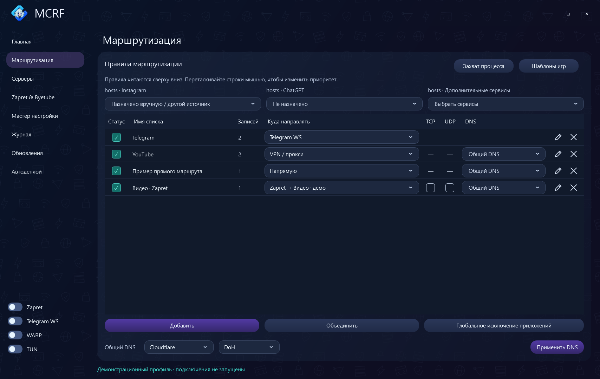
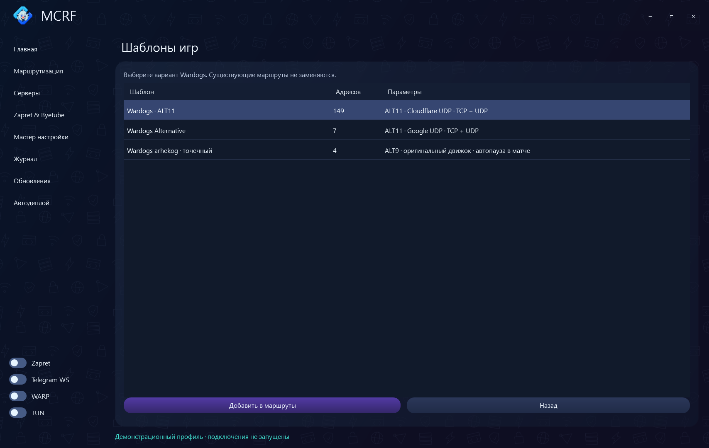

### Серверы

- **VPN / прокси:** импорт ссылок, файлов и подписок, обновление подписок, измерение задержки, выбор и копирование подключения. Автовыбор первого рабочего или самого быстрого сервера; по умолчанию замер раз в 60 с, отклонение 50 мс.
- **WARP:** зашифрованный выход через Cloudflare; создание профилей, выбор страны и WireGuard/AmneziaWG, переподбор адреса и удаление профиля.
- **Протоколы:** таблица встроенных и дополнительных движков, их возможностей и состояния установки.

Протоколы: VLESS, VMess, Trojan, Shadowsocks, Hysteria/Hysteria2, TUIC, AnyTLS, NaiveProxy, SSH, HTTP/SOCKS5, WireGuard/AmneziaWG. Транспорты VLESS: TCP, gRPC, WebSocket, HTTPUpgrade и XHTTP; TLS и REALITY.

VPN / прокси, WARP и протоколы

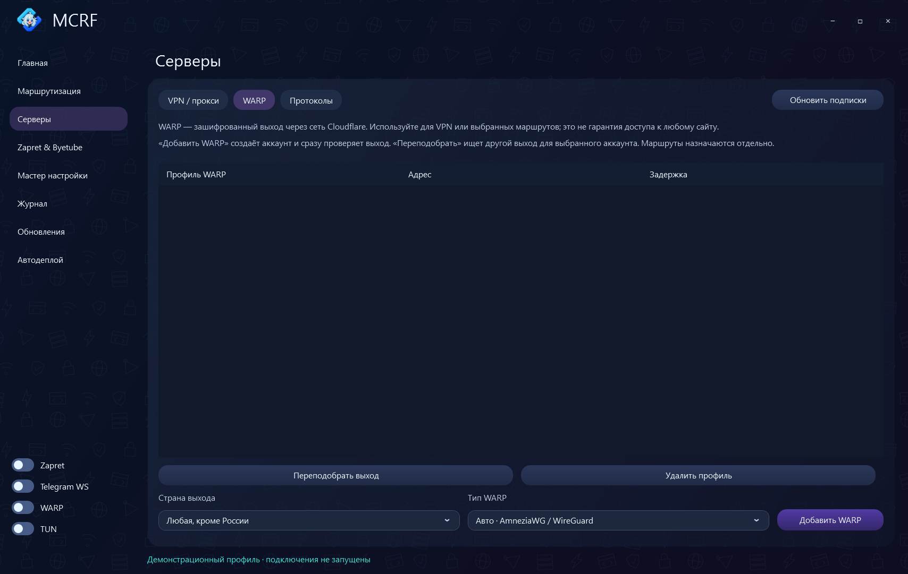
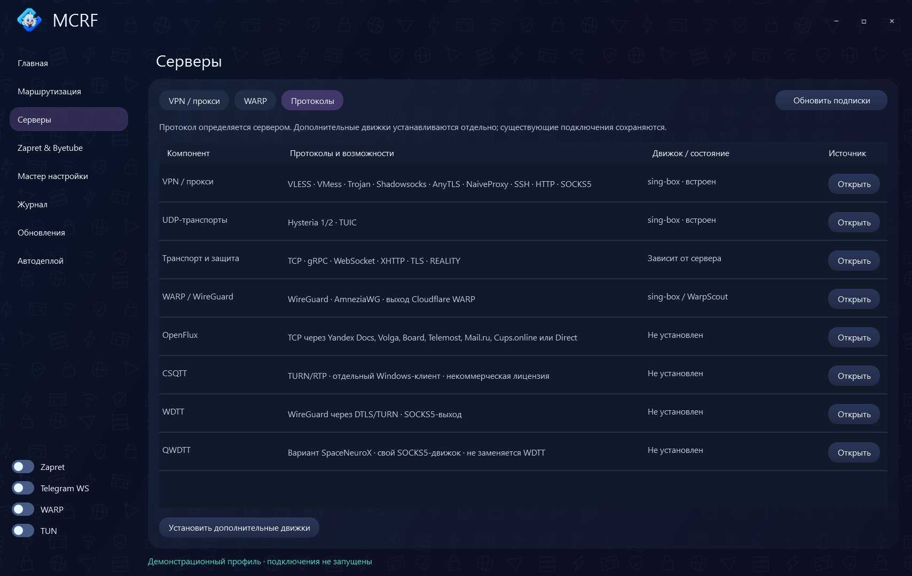

### Zapret & ByeTube

**Zapret:** создание и переименование профилей, выбор стратегий Flowseal/V/YouTube и своих копий, включение профилей, назначение пресетов и горячих клавиш.

**ByeTube:** выбор стратегии ByeDPI, включение локального обхода и назначение маршрутов.

**Редактор стратегий:** отдельная копия стратегии, конструктор или текст BAT, прокручиваемая лента блоков, таблица «название — значение — пояснение», подсказки и предпросмотр. BAT импортируется как конфигурация, а не исполняется.

**Генератор стратегий:** выбор сервисов, профиля, имени и бюджета 12/24 проверок; подбор вариантов и сохранение выбранной стратегии.

Профили, ByeTube, редактор и генератор

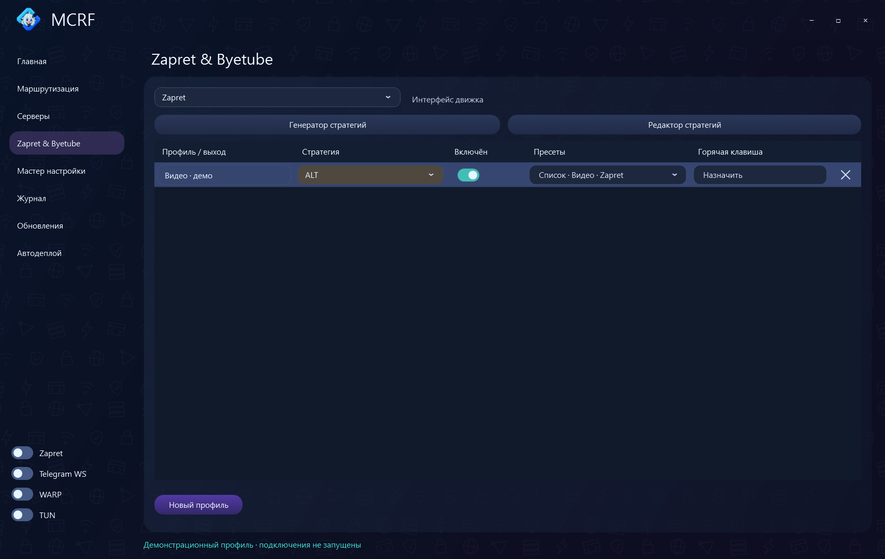
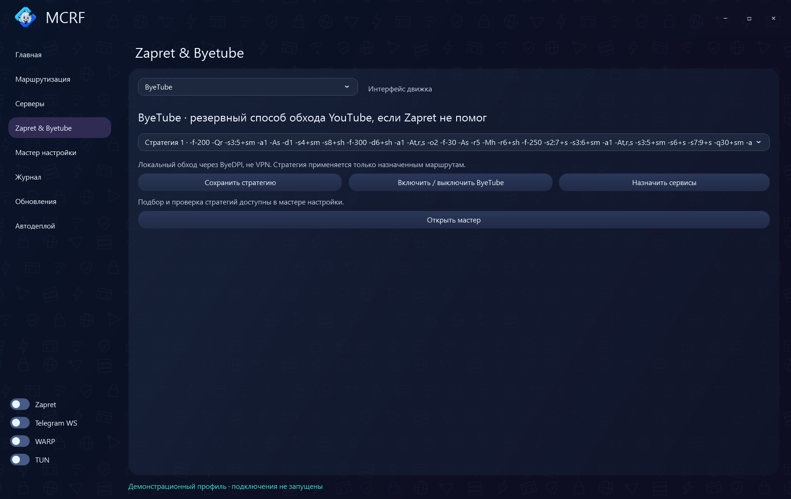

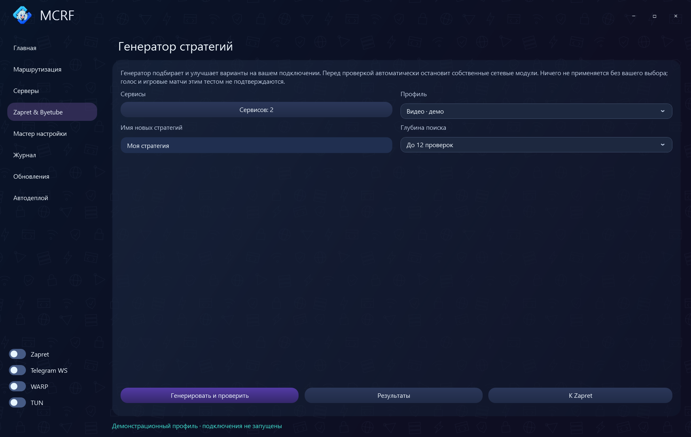

### Мастер настройки

Проверка выбранных сервисов сначала без обхода, затем со стратегиями Flowseal, V, YouTube, своих копий и ByeTube. Проверку можно остановить; завершённые результаты сохраняются.

В разделе «Результаты» доступны отчёт, выбор подходящего варианта и назначение его профилю.

Мастер настройки

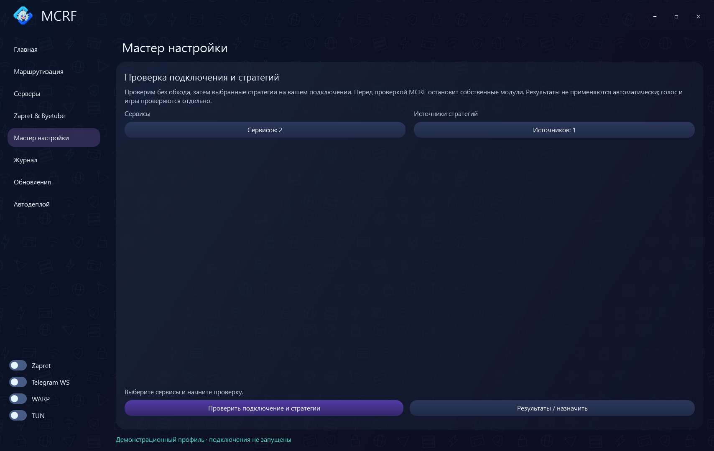

### Журнал

События клиента и сетевых движков, цветные строки, вкладки по компонентам и фильтр ошибок. Кнопка «Копировать» копирует события выбранной вкладки.

Журнал

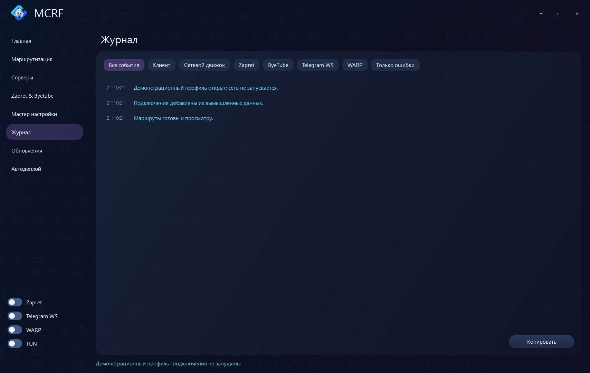

### Обновления

Четыре категории: программа и основные движки, дополнительные движки, стратегии Zapret, списки маршрутизации. Проверка вручную или при запуске; текущая и доступная версии, состояние компонента, пропуск версии и открытие источника.

Дополнительные движки скачиваются и устанавливаются здесь с проверкой SHA-256. Новая версия самого MCRF скачивается со страницы релиза.

Обновления

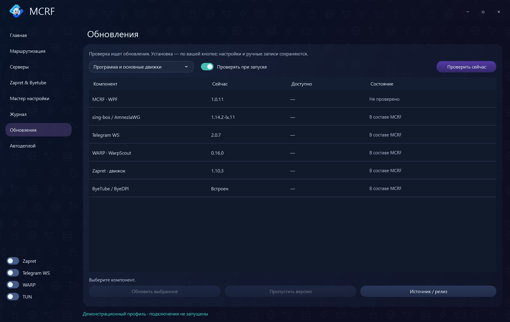

### Автодеплой

Установка панели по SSH на Debian/Ubuntu: пароль сервера или SSH-ключ, адрес, порты и параметры панели.

- **3x-ui (VPN):** создание VLESS TCP и/или gRPC REALITY, выбор портов, SNI и имени gRPC.
- **OpenFlux:** выбор Direct, Yandex Documents, VYandex, Yandex Boards, Telemost, Mail.ru Documents или Cups.online; генерация ключа шифрования.
- **SWG (csqtt, wdtt, qwdtt):** выбор протокола, портов и звонков VK. Ссылки можно вводить вручную, добавлять плюсом или вставлять несколько сразу. Кнопка «Создать 6 звонков VK» открывает вход через vk.ru; для ручных ссылок вход не нужен.

После установки — реквизиты панели и раздел готовых подключений. Для подключения доступны ссылка импорта, ключ/UUID, QR-код и добавление в список серверов.

3x-ui, OpenFlux и SWG

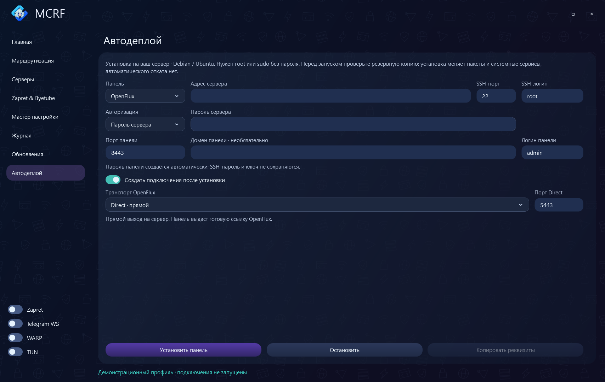
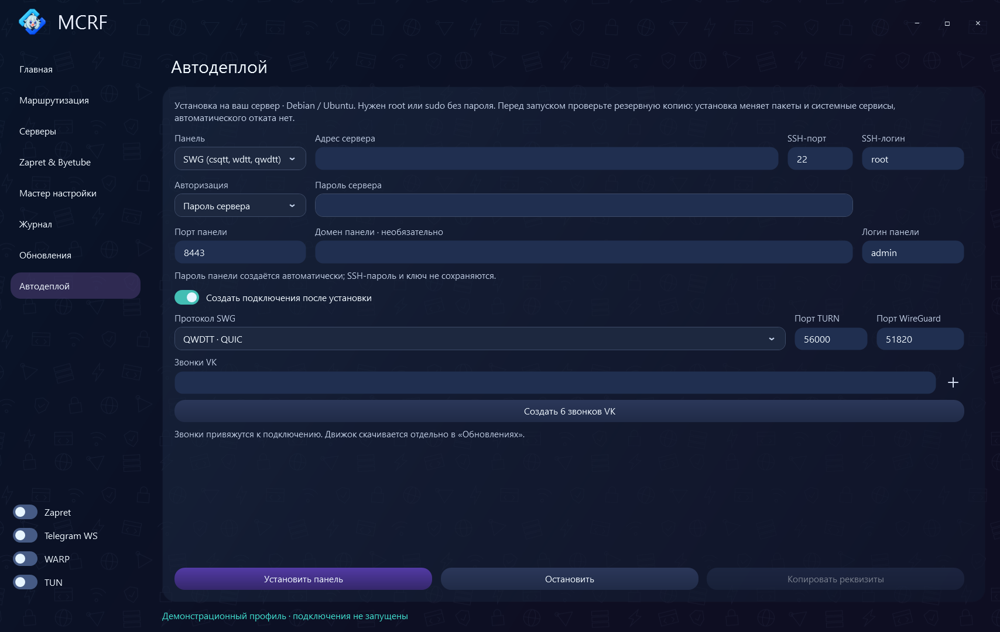

## Дополнительные движки

| Движок | Подключение |
| --- | --- |
| [OpenFlux](https://github.com/p1neappleXpress/OpenFlux) | Туннель с выбором носителя, `openflux://v1/` |
| [CSQTT](https://github.com/amurcanov/csqtt) | TURN/RTP и локальный мост |
| [WDTT](https://github.com/ildarmaga/wdtt) | WireGuard через DTLS/TURN |
| [QWDTT](https://github.com/SpaceNeuroX/proxy-turn-vk-android) | QUIC/TURN и SOCKS5, `qwdtt://config` |

[Пакеты движков](https://github.com/vnenapravo7-source/mcrf/releases/tag/engines-2026-10-13-1) · [Сборка](BUILD.md) · [Структура исходников](DEVELOPMENT.md) · [Сообщить о проблеме](https://github.com/vnenapravo7-source/mcrf/issues) · [VirusTotal](https://www.virustotal.com/gui/file/df10c79cc30fb19dfeb1b60b2ea9316961756889d6520d5aae5fabd23cea7fb7/detection)

Скриншоты сделаны с демонстрационным профилем. Лицензии сторонних компонентов сохранены в приложении и исходниках.
